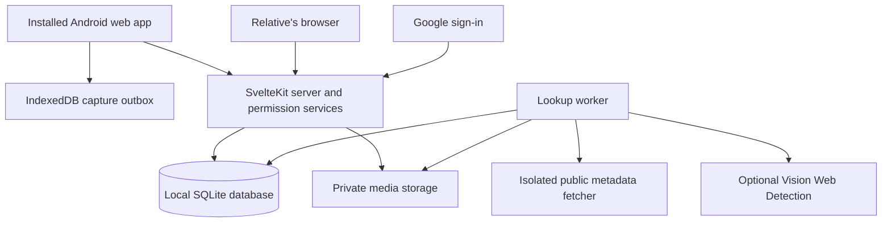
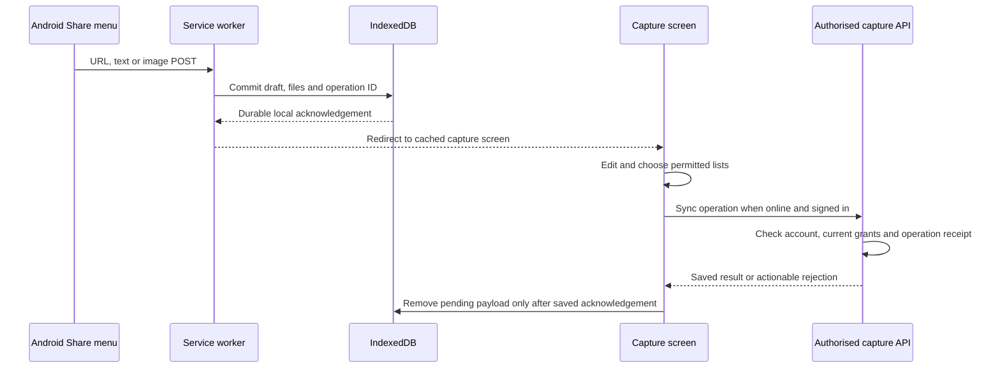
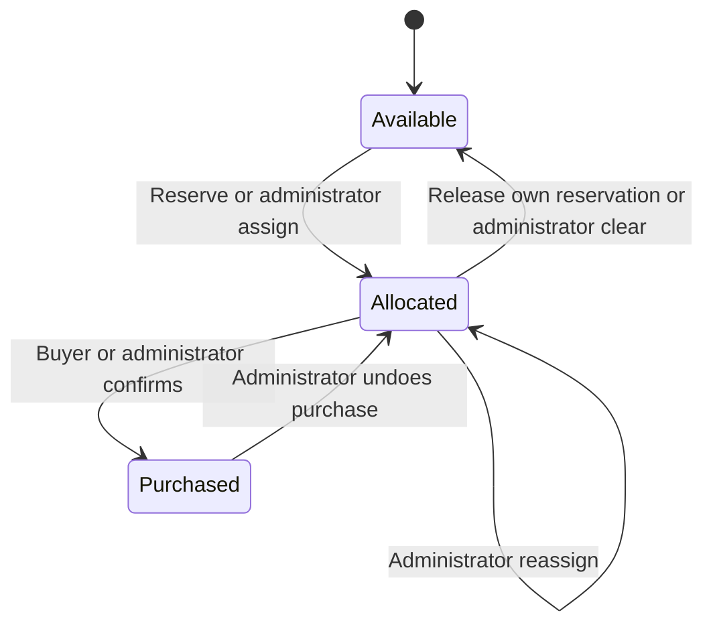
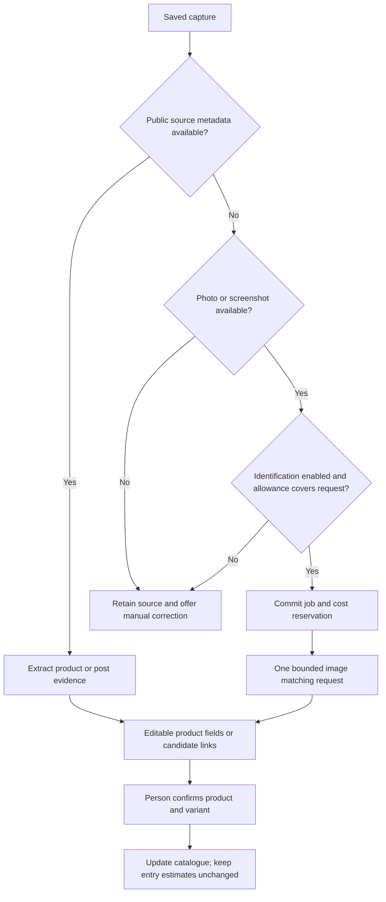

# Family Gift Catalogue - Plan

## Goal Capsule

- **Objective:** The family can save present ideas wherever they find them and coordinate who buys each child's gifts without duplicate purchases.
- **Means:** An installable web app with a home-hosted server, local offline capture and optional image identification (KTD1, KTD4, KTD7).
- **Authority:** The Product Contract governs behaviour; the Planning Contract governs implementation within it; units and examples illustrate those contracts. User instructions take precedence over this plan.
- **Execution profile:** Eight implementation units delivered in four dependent PRs. This document authorises planning only; implementation, provider configuration and deployment are subsequent actions.
- **Completion ownership:** The implementer completes and verifies the application. Ben supplies deployment credentials and the home network details; Ben and his wife perform the actual Android sharing acceptance. Follow the user's repository and PR conventions when implementation is authorised.
- **Stop conditions:** Stop before making paid requests without enabled credentials and allowance, publishing an unauthenticated service, or changing confirmed product scope. Missing deployment credentials do not prevent local implementation with test doubles.

---

## Product Contract

### Summary

Build a private family catalogue with reusable products, recipient and occasion lists, Google sign-in and one administrator.
Capture ideas from Android sharing, pasted links and photos, including offline; coordinate buying through list permissions, reservations, assignments and purchase confirmations.
Host the application and database at home, using optional identification only within a configured allowance.

### Problem Frame

Gift ideas arrive while browsing shops, retailers and social posts, away from a shared planning tool.
The family needs to keep those ideas, organise them for several children and occasions, and tell relatives what remains available without exposing other people's reserved gifts.
The administrator also needs a reliable view of planned and purchased value.

### Actors

| ID | Actor | Responsibility |
| --- | --- | --- |
| A1 | Sole administrator, Ben's wife | Catalogue, lists, invitations, assignments, corrections and all totals |
| A2 | Contributor, including Ben | Add ideas and participate in buying within granted lists |
| A3 | Buyer | Reserve and confirm their own purchases within granted lists |
| A4 | Viewer | Read available ideas and their own administrator assignments |
| A5 | Application and lookup worker | Synchronise captures, enforce access and suggest product matches |

### Requirements

**Catalogue and organisation**

- R1. A product exists independently of lists and can appear on zero, one or several lists; it retains its source, images, description, variant, optional prices, shopping links and original contributor.
- R2. Lists belong to a recipient and optionally a named occasion; labels such as age suitability organise products without granting access.
- R3. Each product's gift entry on a recipient and occasion list has its own buyer and purchase state; buying it for Luke leaves Max's entry available.
- R4. The administrator can search and edit the complete catalogue, manage recipients, lists and labels, archive lists, and inspect each product's memberships and contributor.
- R5. Contributors can add ideas to lists where they have contributor access or to an unlisted inbox visible to themselves and the administrator; buyers and viewers cannot add ideas.

**Identity and visibility**

- R6. Google is the sole sign-in provider, exactly one configured account is administrator, and other accounts need invitations before accessing family data.
- R7. The administrator grants contributor, buyer or viewer access per list and can revoke it; contribution includes buying rights but never invitation or administrator powers.
- R8. Non-administrators see available entries and their own reserved, assigned or purchased entries within their grants; other people's allocated entries and their metadata are absent from current responses.
- R9. Cross-list membership, recipient, buyer, attachment and aggregate information is disclosed only where the caller is entitled to it; shared products do not expose hidden lists.

**Buying and totals**

- R10. Buyers and contributors can reserve an available entry for themselves and release their own unpurchased reservation; the administrator can assign an entry to an already signed-in person with access to its list.
- R11. Reservation and assignment require current online data and one authoritative winner; a competing action receives the changed availability instead of creating a second buyer.
- R12. Buyers and contributors can mark their own allocation purchased; the administrator can record purchases, undo them and reassign unpurchased entries. A viewer's allocation is updated by the administrator.
- R13. The administrator sees per-list totals for all active gift entries, all allocated entries including purchased ones, and all purchased entries; each total also shows the count of entries whose relevant value is unknown.
- R14. List estimates are in GBP and are stored per gift entry; purchased value uses an optional actual GBP amount, otherwise its visibly labelled estimate. Foreign prices remain in their original currency until a GBP estimate is entered.

**Capture and identification**

- R15. An installed Android web app accepts shared URLs, text and photos; manual paste, photo upload and text-only entry remain available.
- R16. Previously initialised devices can save and edit capture drafts offline, including images and chosen lists, and show whether each draft is local, synchronising, saved or needs attention.
- R17. Reconnection, reopening the app or explicit retry synchronises a draft once without losing it when a request or response fails; expired sessions or revoked grants leave the draft recoverable.
- R18. Retailer URLs prefill available product metadata and prices; missing or uncertain fields remain editable rather than becoming invented values.
- R19. An explicit identification action uses a photo, screenshot or accessible social-post information to suggest products and buying links for confirmation; an inaccessible or ambiguous post retains its original capture and offers a screenshot or manual correction.
- R20. Confirming a suggestion never silently replaces a saved variant or rewrites a gift entry's agreed estimate; source provenance and retrieval dates remain inspectable.
- R21. Ordinary capture works without paid identification, and the administrator can disable identification or set a monthly allowance that stops further admitted requests when exhausted.

**Operation**

- R22. The server, database and image storage can run on the home server with persistent storage, HTTPS and recoverable backups; relatives can use a browser without installing a native app.
- R23. Sign-out and account switching never upload one person's local drafts as another person; unsynchronised data is not silently discarded.

### Key Decisions

- **Separate buying progress per recipient and occasion.** Governs R2, R3. (session-settled: user-approved — chosen over one purchase state shared by all appearances: the same product can be bought for different children or occasions.)
- **Lists carry permissions; labels organise ideas.** Governs R2, R7, R9. (session-settled: user-approved — chosen over treating every label as an access-controlled list: permissions and buying progress need a distinct context.)
- **Offline capture with online buying decisions.** Governs R11, R16, R17. (session-settled: user-approved — chosen over queuing reservations offline: competing relatives need current availability.)
- **Suggestions with confirmation.** Governs R19, R20. (session-settled: user-approved — chosen over promising automatic exact identification: photos and social posts can be inaccessible or ambiguous.)
- **Retailer checkout.** Purchase links lead to the retailer and the app records progress. (session-settled: user-approved — chosen over checkout inside the app: the required outcome is coordinated purchasing.)
- **Android sharing first.** Governs R15, R22. (session-settled: user-approved — chosen over separate native apps initially: relatives can browse on other devices.)

### Key Flows

- F1. **Capture:** Share or paste an idea, save it locally, select zero or more permitted lists, synchronise it, then optionally identify and confirm a product. Covers R1, R5, R15–R20, R23.
- F2. **Invite:** The administrator creates an invitation for an email and selected list grants, copies its link, and the intended person signs in with Google and accepts it. Covers R6, R7.
- F3. **Buy:** A relative opens a fresh list, reserves an entry, follows a retailer link and confirms purchase; other relatives no longer receive the allocated entry. Covers R8–R12.
- F4. **Allocate:** The administrator chooses an existing signed-in list member, assigns an available entry, and sees the allocation in the list and totals. Covers R10–R14.

### Acceptance Examples

| ID | Covers | Example and expected result |
| --- | --- | --- |
| AE1 | R1, R3 | The same card game is added to Luke's birthday and Max's Christmas lists; Luke's reservation does not change Max's entry. |
| AE2 | R8, R9 | An uncle reserves an entry; another relative receives neither that entry nor its private image, buyer name or hidden-list memberships through direct API requests. |
| AE3 | R11 | Two buyers reserve the same available entry concurrently; exactly one succeeds and the other sees that it is unavailable. |
| AE4 | R16, R17 | A shop photo is saved in flight mode, the app is closed and reopened, then connectivity returns; one product and its requested entries are created and the draft is acknowledged. |
| AE5 | R17, R23 | A capture loses its response, then its author's session expires; reauthentication and retry produce one result, while another account cannot upload it. |
| AE6 | R13, R14 | Three entries have estimates £20, £30 and unknown; the first is reserved and the second purchased for £25. Totals show £50 plus one unknown, £50 allocated, and £25 purchased. |
| AE7 | R18–R20 | A private social post cannot be read; its URL remains saved, a screenshot can be added, and a suggested product requires confirmation before it changes the catalogue. |
| AE8 | R21 | Two identification requests race for the remaining allowance; only requests fully covered by the allowance can be dispatched, including after worker restart. |
| AE9 | R6, R7 | An uninvited Google account signs in, or a valid invite is opened using a different email; neither obtains family data or grants. |

### Scope Boundaries

The active scope is the complete family workflow above, including home deployment instructions and optional identification.

**Deferred to Follow-Up Work:** Native Android or iPhone wrappers and an iPhone share extension; richer multimodal interpretation if image matching proves inadequate; automatic price refresh and price alerts.

**Outside this product's identity:** In-app payments, retailer ordering, a public gift-list network and a platform for multiple independent administrators or households.

**Considered and not built:** A general sync engine for the entire database, because R16 requires capture drafts rather than offline family browsing; a self-hosted vision model, because no suitable hardware or maintenance requirement has been established; social login scraping and browser automation that depends on personal platform credentials, because the confirmed fallback in R19 preserves capture without it. Reconsider only if real usage demonstrates a gap these decisions cannot meet.

---

## Planning Contract

### Baseline and Constraints

The repository contains only Git metadata and has no commits, application code, tests, dependency manifests, project configuration or existing architecture to reuse.
Every source and test path below is a proposed addition.
No build, application test, paid API call or deployment has been performed during planning.
Use British English in the UI and documentation.

### Key Technical Decisions

- KTD1. **One SvelteKit application on the Node adapter.** Use TypeScript, a supported Node LTS, Better Auth, Drizzle with SQLite, Dexie and a small SQLite-backed job worker. This keeps the household deployment to the app, worker and HTTPS proxy without a managed database or Redis. Resolve and lock compatible maintained releases during scaffolding; current documentation spans a SvelteKit major-version transition. Follow [SvelteKit's Node adapter](https://svelte.dev/docs/kit/adapter-node), [Better Auth's SvelteKit integration](https://better-auth.com/docs/integrations/svelte-kit) and its [installation guidance](https://better-auth.com/docs/installation). Arctic is rejected because its [maintainer has deprecated it](https://arcticjs.dev/).
- KTD2. **A gift entry joins a product to one recipient and occasion list.** Lists have a stable recipient and occasion scope, with one canonical list per scope; a recipient's general ideas list uses a distinct no-occasion scope. Labels and recipient overview filters provide alternative views without creating extra gift entries. A unique product/list constraint makes repeated adds idempotent; different occasion lists intentionally represent separate gift intentions. This implements R1–R3 without a separate gift-intention and list-membership layer. The relational choices can be judged from established constraints; competing prototypes would not resolve a remaining structural uncertainty.
- KTD3. **Application-owned permissions over maintained Google authentication.** Better Auth handles OAuth and opaque sessions; server services apply list grants and visibility rules on every path. Bootstrap the single administrator from an explicit verified Google identity setting, bind its Google subject once accepted, and store a singleton administrator reference. Never grant administrator access to the first visitor. Use only identity scopes and exact callback origins; follow [Google OpenID Connect](https://developers.google.com/identity/openid-connect/openid-connect) and [Better Auth's Google provider](https://better-auth.com/docs/authentication/google). Its SvelteKit handler must explicitly populate request-local session context.
- KTD4. **A local transactional capture outbox rather than database replication.** Save capture metadata, blobs and a client operation UUID together in IndexedDB through Dexie, then acknowledge the local commit. Reuse one operation identifier until acknowledgement, with server uniqueness on account and operation and a stored result. Retry on open, online events and user request; Background Sync is supplementary because [support is limited](https://developer.mozilla.org/en-US/docs/Web/API/Background_Synchronization_API). Request persistent storage and handle denial or quota failure visibly under [browser storage rules](https://developer.mozilla.org/en-US/docs/Web/API/Storage_API/Storage_quotas_and_eviction_criteria).
- KTD5. **A service-worker share receiver with no direct server mutation.** Register an installed-PWA multipart POST target for text, URLs and image files, with both image MIME types and extensions. Intercept the share locally, persist it through KTD4, and redirect to the cached capture shell. Extract URLs from shared text as well as the URL field. A signed-out capture starts unbound and needs explicit adoption after sign-in; a capture tied to an account can only sync as that account. A network fallback at the share route ignores session authority and offers recovery instructions instead of creating products. Follow [Chrome's share-target guidance](https://developer.chrome.com/docs/capabilities/web-apis/web-share-target).
- KTD6. **Transactional allocations and stable valuation.** A conditional update or SQLite write transaction changes an entry only from its expected version and availability; an action ID makes retries harmless. Keep buyer, state, allocation provenance, price snapshot and optional actual spend on the entry. Use integer pence, never floating-point GBP; an imported offer preserves its own currency separately. Changes to product offer metadata do not alter entry estimates. Foreign keys, uniqueness and transactions enforce the boundaries of R3, R10–R14.
- KTD7. **Metadata first; Google Vision Web Detection on demand.** Extract JSON-LD Product/Offer followed by ordinary page metadata, retaining uncertainty and variant information. Image matching returns candidate pages and images; reuse the extractor on a small bounded set of candidate pages. Rank and display suggestions without calling them verified matches. This delivers R18–R20 without an autonomous agent or a model runtime. See [Schema.org Product](https://schema.org/Product), [Offer](https://schema.org/Offer) and [Vision Web Detection](https://docs.cloud.google.com/vision/docs/detecting-web).
- KTD8. **Reserve a conservative request cost before every paid dispatch.** With a dedicated personal Vision project, use a configurable default admission allowance of US$1 per UTC calendar month when the administrator enables identification. Account every Web Detection image at the full published US$0.0035 unit price even if a free tier applies; the default therefore admits at most 285 units. Store integer microdollars and a pricing revision. Reserve the whole request atomically, keep ambiguous timeouts charged, and do not automatically retry paid requests. Changing month or restarting a worker cannot release an unresolved reservation. Each duplicate operation reuses its ledger entry. The allowance is an application admission bound, not a claim about a provider's entire bill. [Vision pricing](https://cloud.google.com/vision/pricing) and [Google budget documentation](https://docs.cloud.google.com/billing/docs/how-to/budgets).
- KTD9. **Private responses are never generically cached.** Cache only the versioned public shell and static assets; serve authenticated list responses, images and API data with no-store. Return authorised projections before serialisation and never ship the complete catalogue to clients for filtering. Local storage holds capture drafts only; after R23's explicit sync-or-discard choice on sign-out, remove account-local data. Persist draft schemas through service-worker and IndexedDB upgrades.
- KTD10. **Treat outbound URLs and images as untrusted input.** An isolated metadata-fetch component permits public HTTPS destinations only and validates every redirect and resolved address, including IPv6, against private, loopback, link-local and cloud metadata ranges. Use a resolver/transport that pins the checked address through the connection; DNS validation alone is insufficient. Bound time, response size, redirect depth and decoded image size; never execute fetched scripts or inline HTML. Serve only raster previews, with private originals stored outside public assets. This matters because the app runs beside private home services; the component has no Google credentials or authority to access them.
- KTD11. **Local disk and a conventional HTTPS home deployment.** Use Docker Compose with app, worker and Caddy, persistent database/media volumes and certificate storage. Keep SQLite WAL on local disk, not a network share; expose no database port. Follow [SQLite WAL](https://www.sqlite.org/wal.html), the [online backup API](https://www.sqlite.org/backup.html) and [Caddy automatic HTTPS](https://caddyserver.com/docs/automatic-https). The minimum network route is a public HTTPS subdomain forwarded to the proxy; CGNAT requires an alternative tunnel decided during deployment, without changing application semantics.

### Data Boundaries

Proposed persistent entities are users, provider identities and sessions; singleton application settings; recipients and occasions; lists and grants; hashed invitation tokens; products, offers, private media and labels; gift entries and allocation history; capture operation receipts; lookup jobs and allowance reservations.
U1 creates the domain tables and constraints; U2 creates authentication-owned tables and grant enforcement; U7 alone creates lookup queue and allowance tables.

A recipient and occasion list owns its entries under KTD2.
Re-adding the same product to a list returns its existing entry, preserving its buyer and estimate.
Removing an entry affects that list only; the administrator must explicitly clear an allocation before removing an allocated entry.
Archiving a list preserves its records and administrator totals but removes it from contributor capture choices and non-administrator browsing.
Deleting a label changes neither gift state nor permissions.

### Access Projection

| Capability | Administrator | Contributor | Buyer | Viewer |
| --- | --- | --- | --- | --- |
| Complete catalogue and totals | Yes | No | No | No |
| Add to a granted list / own unlisted inbox | Yes | Yes | No | No |
| See available granted entries | Yes | Yes | Yes | Yes |
| See another person's allocated entry | Yes | No | No | No |
| Reserve / confirm own allocation | Yes | Yes | Yes | No |
| See own administrator assignment | Yes | Yes | Yes | Yes |
| Edit saved catalogue, list rules or grants | Yes | No | No | No |

Contributors edit their capture before submission; the administrator curates submitted product details.
Own unlisted inbox visibility applies only while the product has no gift entry; being its original contributor does not bypass R8 or R9.
Assignment requires an existing signed-in account and active grant to the target list; it never implicitly invites or promotes someone.
Invitation links are copied for the administrator to send using her chosen channel; the app needs no email delivery service.

### High-Level Technical Design

**Components and data ownership**

**Capture protocol**

**Allocation lifecycle**

Allocation source distinguishes a self-reservation from an administrator assignment.
A buyer releases a self-reservation only; they ask the administrator to change an administrator assignment.
Undoing a purchase preserves the existing buyer until a separate clear or reassign action.

**Identification decisions and data flow**

### Costs and Alternatives

Existing home hardware avoids a new hosting subscription; electricity, internet service and any domain registration remain household costs.
SQLite, the application and Caddy need no managed database subscription.
Core capture and buying use no paid identification calls.

At research time, Vision publishes the first 1,000 feature units per month free, then US$3.50 per 1,000 Web Detection units; billing still needs to be enabled.
KTD8 deliberately does not rely on those free units, because other use can consume them.
Its allowance covers this application's admitted Vision work only; use restricted server credentials and a dedicated personal project, with no unrelated workloads sharing them.
Google's ordinary budgets alert rather than stop requests; Vision is not listed among current [spend-cap eligible services](https://docs.cloud.google.com/billing/docs/how-to/budgets-spend-caps).

A native application is deferred under the confirmed Android-first scope; an installed PWA has a documented receive-share path to validate on the actual phone.
Firebase or another managed sync platform adds an external operational dependency that KTD4 does not require.
PostgreSQL remains viable but adds database operation for a household workload SQLite can handle transactionally.
A multimodal model with web grounding may improve identification later, but costs and search fan-out are less predictable than KTD7's bounded image calls.

### Dependencies and Implementation-Time Details

Local implementation needs compatible locked JavaScript packages and a browser automation setup; there are no existing versions to preserve.
Deployment needs a home host architecture, local storage path, public HTTPS hostname and reachability decision, Google OAuth client, explicit administrator identity and backup destination.
These are deployment inputs, not blockers to building the plan with provider test doubles.

Real Android Share menu behaviour, image formats from the wife's phone and storage survival must be checked on that device.
Desktop browser emulation cannot establish those facts.
Native Android/iOS SDKs or MCPs are unnecessary for the selected route; use browser automation and Android Chrome remote debugging at implementation time.

Social metadata access is best effort: TikTok's [embed documentation](https://developers.tiktok.com/docs/en/embed-videos) is transitioning to its [Embed Player](https://developers.tiktok.com/docs/en/embed-player), and neither is a general product database or guaranteed raw-video endpoint.
Instagram's current oEmbed extraction terms could not be verified from its [official documentation](https://developers.facebook.com/docs/instagram-platform/oembed); do not build an identification dependency on it before checking those terms.
Capture and screenshot matching under R19 remain available.
No arbitrary social-video download or reverse-video-search API is assumed.

### System-Wide Impact and Operation

The authentication hook, every list/product route, media handler, outbox sync and job submission must use the same server permission service.
A revoked session or grant is checked again at mutation time; the installed shell is never evidence of permission.
Current hiding cannot erase something a relative already saw, downloaded or photographed.

The worker uses durable job states and a lease for restart recovery, but never releases an uncertain paid dispatch's reservation or retries it automatically under KTD8.
Only metadata and image evidence needed for identification leave the home server; child names, list labels and buyer identities are not sent to Vision.
Retain private original captures and derived previews under opaque identifiers; archived catalogue records retain allocation history.

Produce a runbook for Google setup, HTTPS, persistent volumes, upgrades, database migration, worker failures and restore.
A consistent backup pairs an online SQLite snapshot with its referenced media; temporarily suspend application writes during snapshot assembly and defer media deletion until the backup completes.
Keep backups outside the app's writable runtime volume and test restoration on an isolated instance before real family use.

---

## Implementation Units

### PR1: Private application foundation

Waits on: nothing. Routes introduced here remain unavailable to unauthorised visitors.

### U1. Establish the application and domain model

**Goal:** Create the runnable application and enforce catalogue/list boundaries in persistent storage.

**Requirements:** R1–R4, R14, R22; KTD1, KTD2, KTD6, KTD11.

**Dependencies:** None.

**Files:** `package.json`, lockfile, `svelte.config.js`, `vite.config.ts`, `tsconfig.json`, `src/app.html`, `src/lib/server/db/schema.ts`, `src/lib/server/db/client.ts`, `drizzle/`, `tests/integration/catalogue-model.test.ts`.

**Approach:** Create the scaffold and domain schema owned by this unit, including product/list uniqueness, recipient and occasion scope, estimates, allocation history and operation receipts. Provide migrations and repository services without exposing domain endpoints yet. Pin compatible maintained releases and record their versions in the lockfile.

**Patterns to follow:** KTD1's official integration guidance; SQLite transaction and foreign-key contracts. There is no existing repository pattern.

**Test scenarios:**

1. Apply migrations to an empty database and reopen it; products, lists and integer estimates persist.
2. Add a product twice to one list; its one existing entry and valuation remain intact.
3. Covers AE1. Attach a product to two recipient/occasion lists; entry identities remain independent.
4. Attempt duplicate recipient/occasion list scope or invalid foreign keys; constraints reject the write.

**Verification:** The development server boots, migrations are reproducible and the proposed domain invariants hold. Model tests catch persistence errors but do not prove permissions or screens.

### U2. Enforce identity, invitations and list access

**Goal:** Make all family data private and support the sole administrator's invitations.

**Requirements:** R5–R9, R23; F2; KTD3, KTD9.

**Dependencies:** U1.

**Files:** `src/lib/server/auth.ts`, `src/hooks.server.ts`, `src/lib/server/access.ts`, `src/lib/server/invitations.ts`, `src/routes/api/auth/[...all]/+server.ts`, `src/routes/invite/[token]/+page.server.ts`, `src/routes/settings/people/+page.svelte`, `src/lib/server/db/auth-schema.ts`, `drizzle/`, `tests/integration/access.test.ts`, `tests/integration/invitations.test.ts`.

**Approach:** Integrate Better Auth, create its owned schema, populate server request context, and enforce the access projection before any catalogue route is exposed. Hash single-use invitation tokens, bind invitations to the intended Google-verified email and bind accepted membership to a stable identity. Apply ordinary origin/CSRF protections to all authenticated mutations. Copy invitation links rather than sending external messages.

**Test scenarios:**

1. Covers AE9. Reject uninvited users, mismatched invitation emails, expired tokens and token replay without returning family data.
2. The configured administrator signs in; a first visitor or invited account cannot become a second administrator.
3. Google cancellation or an invalid OAuth state returns to sign-in without creating grants.
4. An expired/revoked session and a newly revoked list grant cannot mutate or read the protected resources.
5. Covers AE2. Query a shared product, hidden entry, private image and aggregate endpoint with only one list grant; responses reveal no inaccessible membership or allocation.

**Verification:** Role and resource checks pass through actual server handlers, not only helper calls. Provider test doubles prove local handling; one real Google callback is a later deployment check.

### PR2: Catalogue and coordinated buying

Waits on: PR1 merge order only. This group can be built against PR1 before it merges.

### U3. Build catalogue, lists and capture editing

**Goal:** Give the administrator and contributors a usable catalogue and list workflow.

**Requirements:** R1–R5, R8, R9, R15; F1; KTD2, KTD9, KTD10.

**Dependencies:** U1, U2.

**Files:** `src/routes/catalogue/+page.svelte`, `src/routes/lists/[id]/+page.svelte`, `src/routes/capture/+page.svelte`, `src/routes/inbox/+page.svelte`, `src/lib/server/catalogue.ts`, `src/lib/server/media.ts`, `src/routes/api/products/+server.ts`, `src/routes/api/lists/[id]/+server.ts`, `src/routes/api/media/[id]/+server.ts`, `src/lib/components/`, `tests/integration/catalogue-access.test.ts`, `tests/e2e/catalogue.spec.ts`.

**Approach:** Build mobile-first forms and views using the server access service. Show authorised cross-list badges, contributor attribution, recipient/occasion context and source evidence. Keep submitter capture editing before submission and administrator curation afterwards. Store originals outside public static files and generate safe raster previews. Make selection of several lists create/reuse their independent entries.

**Test scenarios:**

1. The administrator creates children, occasion lists and labels, then finds an item by name or label and sees its authorised memberships.
2. A contributor saves an unlisted idea and adds another idea to two granted lists; buyers and viewers cannot call the addition endpoints.
3. An invalid or newly revoked target list rejects the entire submission with no partial product/list write.
4. A contributor sees neither hidden memberships nor a previously submitted allocated gift through an author-only catalogue bypass.
5. An image cannot be fetched without current resource access; oversized or undecodable media produces an actionable error without discarding the original local draft.
6. Archiving a list removes it from capture choices and relative browsing while preserving the administrator's history.

**Verification:** Forms work at phone width and with keyboard navigation; direct API checks agree with the visible role boundaries. Browser tests cover screens, while integration tests establish resource enforcement.

### U4. Implement allocations, purchase confirmation and totals

**Goal:** Let relatives coordinate gifts with one buyer per entry and accurate administrator totals.

**Requirements:** R3, R8–R14; F3, F4; KTD6.

**Dependencies:** U2, U3.

**Files:** `src/lib/server/allocations.ts`, `src/lib/server/totals.ts`, `src/routes/api/entries/[id]/allocation/+server.ts`, `src/routes/my-gifts/+page.svelte`, `src/lib/components/GiftActions.svelte`, `src/lib/components/ListTotals.svelte`, `tests/integration/allocations.test.ts`, `tests/integration/totals.test.ts`, `tests/e2e/buying.spec.ts`.

**Approach:** Implement the allocation lifecycle, versioned conditional writes and recorded actor/action provenance. Add My gifts and administrator assignment controls, then calculate the three totals over distinct active entries using R13 and R14. Render current availability only after an online refresh.

**Execution note:** Prove the competing allocation transaction before wiring the purchase buttons.

**Test scenarios:**

1. Covers AE3. Simultaneous reservations, and a reservation racing an administrator assignment, produce one buyer.
2. Covers AE1 and AE2. Reserving Luke's entry hides it from another relative while Max's entry stays available.
3. Duplicate action delivery does not create a second allocation event or inflate totals.
4. Only the owning buyer or administrator can confirm purchase; a viewer sees their assignment but cannot update it.
5. Releasing a self-reservation restores availability; purchased entries need explicit administrator undo before clearing or reassignment.
6. Covers AE6. Verify all three totals with actual costs, estimates, unknowns, zero cost and untranslated foreign prices.
7. Refreshing a product offer leaves an existing entry's estimate and purchased actual unchanged.

**Verification:** Concurrent tests use separate database connections against a temporary local SQLite database. Screen tests establish that a relative can find their allocation and record buying progress without seeing other buyers.

### PR3: Offline Android capture

Waits on: PR2 merge order only. This group can be built against earlier groups before they merge.

### U5. Implement durable drafts and synchronisation

**Goal:** Preserve captures across offline use, failed responses, app updates and reauthentication.

**Requirements:** R5, R16, R17, R23; F1; KTD4, KTD9.

**Dependencies:** U2, U3.

**Files:** `src/lib/client/drafts.ts`, `src/lib/client/sync.ts`, `src/lib/shared/capture.ts`, `src/lib/server/capture-sync.ts`, `src/routes/api/captures/+server.ts`, `src/lib/components/SyncStatus.svelte`, `tests/integration/capture-sync.test.ts`, `tests/e2e/offline-capture.spec.ts`.

**Approach:** Implement the transactional outbox, account-bound drafts and operation receipts. Stage media safely and commit the capture result atomically; retry receipts return the original saved IDs. Require current grants at commit time, leaving rejected captures intact locally. Implement the explicit pending-draft sign-out choice and storage migration behaviour under KTD4 and KTD9.

**Test scenarios:**

1. Covers AE4. Save text, lists and photo blobs offline, reload, then synchronise once.
2. Covers AE5. Lose a successful response and retry after reauthentication; no duplicate products, entries or media are created.
3. A revoked grant, expired session or server outage preserves the draft and identifies the required next action.
4. Account B cannot read in-app or upload account A's drafts; sign-out warns before discarding pending captures.
5. An IndexedDB upgrade preserves pending blobs and operation IDs; storage quota failure never reports a successful local save.
6. A rejected multi-list sync produces no partial memberships or falsely acknowledged draft.

**Verification:** Browser tests exercise a real IndexedDB store and network transitions. Server tests establish atomicity and receipts; real-device persistence remains part of U8 acceptance.

### U6. Add the installed Android share target

**Goal:** Make capture available directly from the Android Share menu, including offline.

**Requirements:** R15–R17, R23; F1; KTD5.

**Dependencies:** U5.

**Files:** `static/manifest.webmanifest`, `static/icons/`, `src/service-worker.ts`, `src/routes/share/+server.ts`, `src/lib/client/share-import.ts`, `tests/e2e/share-import.spec.ts`, `docs/android-acceptance.md`.

**Approach:** Register the manifest, precache the public capture shell and intercept the dedicated share route. Reuse the draft persistence code and accept links placed in text fields. Document installation and Chrome remote debugging. A service-worker update must preserve drafts and avoid activating over an unfinished share import.

**Test scenarios:**

1. Simulated URL-only, text-with-URL and image multipart shares become editable local drafts.
2. A signed-out share can be adopted only after explicit confirmation by an authorised account.
3. An external POST to the share route cannot use ambient cookies to write the server database or change an allocation.
4. With the network unavailable, the installed capture shell opens and confirms persistence only after IndexedDB commits.
5. Unsupported media and an uninitialised/missing service worker provide recovery information rather than a false saved message.

**Verification:** Browser automation proves parsing and service-worker handling; the actual Android Share menu and process restart are proved by the U8 device checklist, with Instagram, TikTok, a retailer page and a shop photo.

### PR4: Product enrichment and home operation

Waits on: PR3 merge order only. This group can be built before earlier merges. Paid lookup remains inaccessible until its allowance enforcement is present.

### U7. Add metadata extraction and capped identification

**Goal:** Turn saved sources into useful editable product suggestions without uncontrolled API spending or access to the home network.

**Requirements:** R18–R21; F1; KTD7, KTD8, KTD10.

**Dependencies:** U2, U3, U5.

**Files:** `src/lib/server/enrichment/metadata.ts`, `src/lib/server/enrichment/fetch.ts`, `src/lib/server/enrichment/vision.ts`, `src/lib/server/enrichment/allowance.ts`, `src/lib/server/enrichment/jobs.ts`, `src/worker.ts`, `src/routes/api/products/[id]/identify/+server.ts`, `src/routes/settings/identification/+page.svelte`, `src/lib/components/ProductSuggestions.svelte`, `drizzle/`, `tests/fixtures/retailers/`, `tests/integration/enrichment.test.ts`, `tests/integration/allowance.test.ts`, `tests/integration/public-fetch.test.ts`.

**Approach:** Create this unit's queue and allowance schema, then implement isolated public fetching, metadata extraction and the bounded matching job. Keep runtime provider credentials out of the fetch component. Surface raw evidence, optional prices, variants and a confirmation action; display job failure and exhausted allowance without blocking ordinary capture. Strip personal metadata from the derivative image sent to Vision.

**Test scenarios:**

1. Extract a Product/Offer with GBP price; preserve missing currency, aggregate from-prices and ambiguous variants as uncertainty.
2. Covers AE7. A private social URL, blocked retailer or unmatched photo retains the capture and presents screenshot/manual correction.
3. Reject localhost, RFC1918, link-local, IPv6 private targets, public-to-private redirects and DNS rebinding without reaching the protected service.
4. Covers AE8. Concurrent jobs cannot exceed the remaining allowance; repeated operation IDs cannot reserve or dispatch twice.
5. A timeout or worker crash after uncertain dispatch keeps the cost reservation and requires an explicit new attempt.
6. UTC month rollover, disabled identification and pricing revision changes preserve prior reservations and respect the current admission limit.
7. Confirming a suggestion updates only the intended product fields, preserving source evidence, attribution and existing entry estimates.
8. Google calls contain the derivative image and required request fields, without child names, list contents or buyer identities.

**Verification:** Recorded fixtures and provider doubles prove extraction, isolation, job state and cap arithmetic. A credentialed one-image check is optional until explicitly enabled and remains subject to KTD8.

### U8. Package, document and accept home operation

**Goal:** Deliver a reproducible home deployment and prove the complete family workflow on the actual devices.

**Requirements:** R6, R15–R17, R21–R23; all acceptance examples; KTD1, KTD11.

**Dependencies:** U1–U7.

**Files:** `Dockerfile`, `compose.yaml`, `Caddyfile`, `.env.example`, `.github/workflows/checks.yml`, `README.md`, `docs/deployment.md`, `docs/backup-restore.md`, `docs/android-acceptance.md`, `scripts/backup.mjs`, `tests/integration/backup-restore.test.ts`, `tests/e2e/family-journey.spec.ts`.

**Approach:** Package app and worker from the same locked release, mount local persistent storage, and configure HTTPS and trusted proxy origins according to the selected framework version. Add backup/restore and migration instructions, a liveness/readiness boundary and a public-data-free diagnostic view for the administrator. Record required environment values without secrets. Configure CI for the Verification Contract.

**Test scenarios:**

1. Restart the containers; sessions, catalogue, allocations, media and uncertain lookup reservations survive.
2. Restore a backup into an isolated instance and open its media and gift entries without broken references.
3. A proxy-origin misconfiguration fails visibly; private responses remain uncached and direct database ports are not exposed.
4. Walk F1–F4 with administrator, contributor, buyer and viewer accounts using a clean deployment.
5. Complete Android installation, sharing, flight mode, app termination/reopen and later sync with the wife's real phone.
6. Open relative views on an iPhone browser; availability refresh, Google sign-in and retailer links work without PWA installation.

**Verification:** Distinguish CI/local acceptance, actual device acceptance and public home deployment evidence. Do not report deployment or device behaviour verified from container or desktop tests alone.

---

## Verification Contract

No application tests run during planning.
U1 introduces the following package scripts; they are proposed interfaces, not existing commands.
Use isolated temporary databases and media directories, never a household live database.

| Proposed check | Proves | Limitation |
| --- | --- | --- |
| `npm run check` | Svelte and TypeScript correctness | Does not prove runtime behaviour |
| `npm run lint` | Repository source conventions | Does not prove permission or sync semantics |
| `npm run test:unit` | Pure parsers, money and state rules | Does not prove persistence or UI |
| `npm run test:integration` | SQLite constraints, server permissions, races, job ledger and restore | Provider doubles do not establish live integration |
| `npm run test:e2e` | Browser flows, IndexedDB and service worker behaviour | Cannot establish the native Android Share menu |
| `npm run build` | Production app and worker packaging | Does not establish home-network reachability |

Required acceptance additionally includes the U8 real-device checklist, one real Google sign-in after OAuth setup, and restore verification.
A paid provider check must be explicitly enabled, use an admitted request and record its outcome separately.
Network boundaries and concurrency must be tested through real handlers/connections, rather than testing only mocks of the relevant enforcement.

---

## Definition of Done

- R1–R23 are implemented and traced through the units; AE1–AE9 hold under their stated conditions.
- Every unit's feature tests and observable verification outcomes are satisfied, with any unavailable device or deployment acceptance explicitly outstanding.
- The sole administrator can organise ideas and totals, contributors can capture ideas offline, and relatives can coordinate purchases without receiving another buyer's allocated entries.
- CI checks pass against the final source revision and production containers restart with persistent data intact.
- Credentials and child/family data are absent from the repository, logs and public static assets; identification traffic respects KTD8 and KTD10.
- Deployment and restore instructions include the actual supported architecture, storage paths, Google callback URL and access route once configured.
- Experimental code, unused packages and abandoned approaches are removed before the implementation is declared complete.
- A merged PR is recorded separately from a deployed service; actual Android sharing and public home operation require their own evidence.
