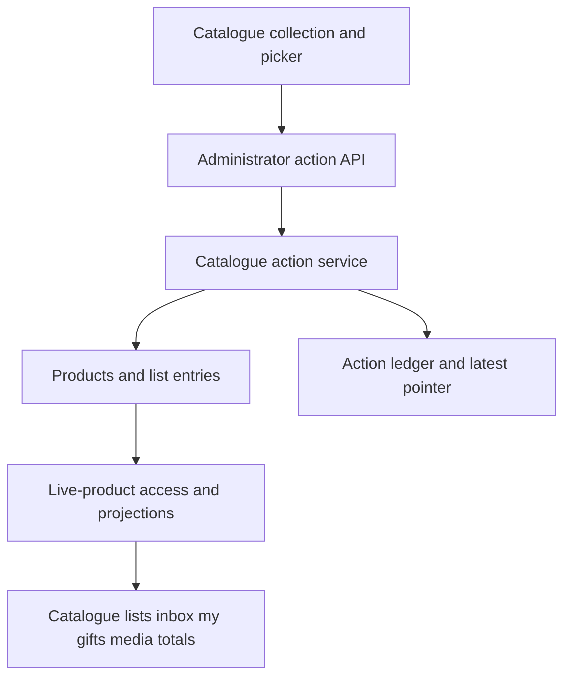
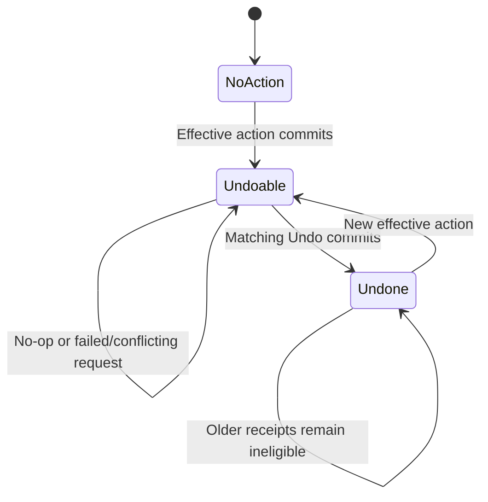
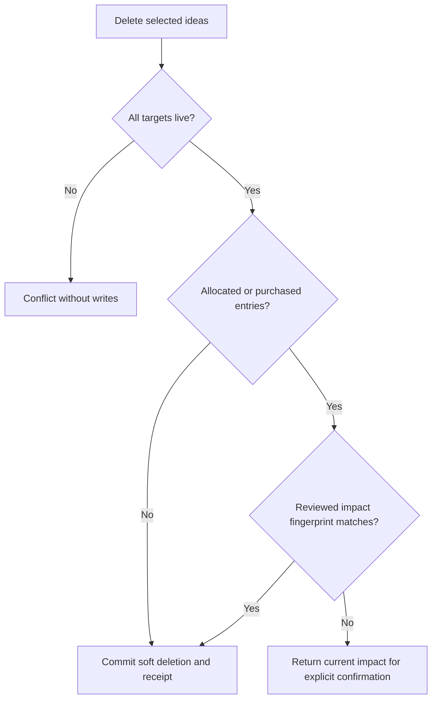

# Catalogue List Actions - Plan

## Goal Capsule

- **Objective:** The administrator can quickly organise several gift ideas across dozens of lists and recover an accidental addition or deletion.
- **Means:** Catalogue selection, a searchable list picker and recoverable catalogue actions (KTD1–KTD4).
- **Authority:** The user's request and current instructions govern; Product Contract governs behaviour and Planning Contract governs implementation.
- **Execution profile:** One local feature, with three disjoint implementation workers after agreeing the shared action contract, followed by integration. Local commits only; no remote, PR, Jira, deployment or external source upload.
- **Completion ownership:** The implementing agent completes U1–U4 and local verification. Real Google sign-in, home-server deployment and real-device acceptance remain separate.
- **Stop conditions:** Do not weaken current authentication or list visibility, destroy buying history, alter offline capture, or use the production database to verify the feature.

---

## Product Contract

### Summary

Add quick single and multiple idea actions to the catalogue, with a destination picker that remains usable when there are tens of lists.
Provide an Undo last action button for mistaken list additions and catalogue deletions.

### Problem Frame

Organising ideas through the full product editor adds friction when several ideas need the same destinations.
Long lists of destinations also make the wrong choice easier, and the catalogue currently provides no deletion action or corresponding recovery.

### Requirements

**Catalogue actions**

- R1. The administrator can add one or more catalogue ideas to one or more existing lists quickly.
- R2. The administrator can delete one or more ideas from the catalogue and undo an accidental deletion.
- R3. A visible Undo last action button reverses the latest effective catalogue list addition or deletion.
- R4. List selection remains quick and understandable with tens of lists.

**Existing contracts retained**

- R5. Products remain independent of lists, with separate per-list GBP estimates, allocation, purchase values and history; existing memberships are preserved by addition.
- R6. Google remains the sole sign-in provider with one administrator, current role checks and private product/media access.
- R7. Capture drafts, offline synchronisation and capture idempotency retain their current behaviour.

### Scope Boundaries

This feature concerns catalogue organisation and its direct consequences for existing views.
Permanent purge, a trash manager, redo, multi-step Undo and a bulk offline queue are considered and excluded: they do not serve the requested quick recovery and introduce additional data lifecycles.
There is no new list-creation flow, identification provider or component library.

### Acceptance Examples

- AE1. **Covers R1, R4, R5:** Select five ideas and two destination lists; a list already containing three receives only its missing two, and previous prices and purchases remain unchanged.
- AE2. **Covers R2, R3:** Delete an idea, reload the catalogue and use Undo; its existing list memberships, photographs and buying state return.
- AE3. **Covers R3, R5:** Add an idea to the wrong list, then reserve that new entry elsewhere; Undo reports the conflict and does not remove the reservation.
- AE4. **Covers R4:** Search among 50 lists by recipient or occasion, select destinations across successive searches and submit once.

---

## Planning Contract

### Assumptions

These are implementation defaults inferred from the request, rather than additional user-confirmed product decisions.

- A1. Catalogue-only checkboxes select visible ideas, with select-all-matching and a sticky selected-count bar containing Add to lists, Delete and Clear. Filter/query changes clear idea selection; switching cards/compact layout preserves it.
- A2. Each idea exposes Add to lists directly and Delete in a quiet overflow. Both use the same action path as bulk operations.
- A3. The destination dialog searches active lists by recipient, list name and occasion. It preserves selected destinations across search, shows a selected summary and count, and labels partial membership as “3 of 5 already listed”; fully satisfied destinations are non-actionable.
- A4. Delete hides the entire idea from catalogue, lists, inbox, my gifts, direct product/media access and totals. Existing records and photographs remain for recovery.
- A5. Ordinary deletion is immediate and recoverable. Deletion affecting allocated or purchased entries requires one impact confirmation covering the reviewed impacts; changed impacts require renewed confirmation.
- A6. Undo survives reload and has no timed toast expiry. Only the latest effective catalogue action is eligible; no-op additions preserve the previous action, and undoing the latest does not uncover older actions.
- A7. These actions require an online acknowledgement. An ambiguous response retains a frozen request and operation ID for explicit retry; the UI does not permit a competing catalogue mutation until the request is acknowledged or reconciled.
- A8. Bulk selection includes all currently matching ideas without arbitrary idea or destination caps or silent truncation. Existing HTTP body limits still apply.
- A9. New memberships inherit the shared known GBP estimate when all current active memberships agree. With no active memberships, use the sole distinct known GBP offer price; missing or conflicting evidence starts unknown. Foreign offers and actual purchase amounts are never treated as a GBP estimate.

### Key Technical Decisions

- KTD1. **Extend shared cards with catalogue-only action slots.** Keep selection and action state in the catalogue collection/controller; the same ProductCard and IdeaCollection still serve lists, inbox and my gifts without catalogue controls. Governs implementation of A1–A3 and R1, R4.
- KTD2. **Use an additive catalogue action service.** Do not reuse product PATCH, which replaces membership selections and can remove available entries/history. Reuse `addProductToList` conflict-do-nothing behaviour and record only newly created entries for recovery. Implements R1, R5 and A9.
- KTD3. **Soft-delete products.** Add nullable `products.deletedAt` and an action-specific deletion token, retaining media, entries, allocation history and capture receipts. Restrictive foreign keys make destructive deletion unsuitable for R2, R5 and R7.
- KTD4. **Persist action receipts and a per-administrator latest-action pointer.** One additive migration creates a catalogue action ledger with unique actor/operation ID, canonical request fingerprint, kind, affected-record snapshots, result and undone state. A separate latest pointer changes only for effective add/delete actions. This gives A6 without relying on browser storage or receipt timestamp ordering.
- KTD5. **Use short immediate transactions for decisions and writes.** Fresh administrator checks, product/list validation, impact verification, mutations, receipt insertion and latest-pointer update form one synchronous transaction. Use prepared statements or bounded query batches to avoid SQL bind limits while retaining one atomic action. No network or media work occurs inside it. This follows existing allocation transactions and [SQLite transaction semantics](https://www.sqlite.org/lang_transaction.html).
- KTD6. **Undo validates exact effects before reversing them.** Add Undo deletes only its newly created entries, each still available with its full initial snapshot and no allocation history; delete Undo restores only matching deletion tokens and unchanged affected snapshots. Entry version alone is insufficient because product PATCH changes estimates without advancing version. A mismatch aborts the whole Undo with 409; no later buying or editing is rolled back.
- KTD7. **Bind requests and confirmations to what the administrator chose.** Replaying an operation ID with the same canonical payload returns its recorded outcome without reapplying effects or moving the latest pointer; a different payload conflicts. Undo includes the displayed expected action ID and its own operation ID. Delete confirmation includes an impact fingerprint covering affected non-available entry IDs, states and versions, rechecked under KTD5.
- KTD8. **Use a labelled native modal dialog.** Apply the [WAI modal interaction contract](https://www.w3.org/WAI/ARIA/apg/patterns/dialog-modal/), with search focus, keyboard containment, visible cancellation and logical focus return. Cancellation before submission writes nothing; closing after submission cannot cancel the request. Deleting the invoking card moves focus to the persistent action/Undo status region.

No bake-off is needed: durable receipts and soft deletion follow existing transactional and restrictive-FK contracts, while a client-only inverse cannot satisfy reload recovery or protect later buying state.

### High-Level Technical Design

**Ownership and data flow (KTD1–KTD5):**



**Write protocol (KTD5–KTD7):**

```mermaid
sequenceDiagram
  participant UI as Catalogue
  participant API as Action service
  participant DB as SQLite
  UI->>API: Frozen request with operation ID
  API->>DB: Begin immediate; fresh authorisation
  API->>DB: Replay lookup or validate all targets and impact
  API->>DB: Apply effects, receipt and latest pointer
  DB-->>API: Commit or roll back together
  API-->>UI: Recorded acknowledgement or actionable conflict
```

**Recovery lifecycle (A6, KTD4, KTD6):**



**Delete decision gates (A5, KTD7):**



**API surface (proposed, owned by U1):**

| Endpoint | Purpose | Contract |
| --- | --- | --- |
| `GET /api/catalogue-actions` | Current latest action | Administrator-only summary and eligible action ID, private/no-store |
| `POST /api/catalogue-actions` | Add or delete | Operation UUID, kind and idea IDs; list IDs for add or reviewed impact fingerprint for delete |
| `POST /api/catalogue-actions/undo` | Reverse displayed action | Operation UUID and expected action ID |

Successful replies contain the action acknowledgement, affected counts and current Undo summary. Invalid input is 400, signed-out/revoked access is 401/403, and stale targets, changed confirmation, reused IDs or unsafe Undo are 409 with a distinguishable reason. Responses never include hidden product data to unauthorised actors.

### Existing Behaviour and System-Wide Impact

`productPatch` uses an immediate transaction and rejects removing non-available memberships; it updates entry estimates without incrementing `version`. `addProductToList` leaves existing memberships untouched. Allocation commands perform current-role checks, receipt replay and version comparison inside their write transaction. The new service follows those ownership boundaries rather than changing the editor's replacement semantics.

`canReadProduct` must reject tombstones before its administrator shortcut. `visibleEntries` must exclude tombstoned products, while `productsGet` must filter them before its throwing projection. Totals and `authorisedEntry` bypass those projections and need direct live-product restrictions. Original and preview media already recheck access after disk reads and remain private/no-store.

Enrichment admission, worker execution and result publication must reject deleted products. Suggestion confirmation and photograph attachment cross asynchronous preparation boundaries and need another live-product check inside the final transaction. Deletion does not imply a dispatched paid request was cancelled; allowance accounting remains intact. Capture receipt replay must acknowledge an existing capture without resurrecting a deleted product.

### Sequencing and Risks

Agree the U1 shared request/result types and tombstone field names first. U1, U2 and U3 may then work concurrently within their exclusive file boundaries; U2/U3 depend on that contract, not on U1 finishing every test. U4 integrates all three before any release.

The principal risk is missing a raw product/entry read or asynchronous commit, leaving a deleted idea readable or mutable. U2 explicitly audits these seams and tests them together. Database and image backups must retain tombstones and receipts so restore preserves the Undo contract; U4 verifies an isolated restore. Apply the additive migration before serving the new build, using existing backup instructions and no destructive down migration.

---

## Implementation Units

### U1. Atomic catalogue actions and durable Undo

**Goal:** Deliver the action service, persistence and administrator API implementing R1–R3, R5–R7, A4–A9 and KTD2–KTD7.

**Dependencies:** Shared contract agreement; no other unit writes these files.

**Files:** `src/lib/server/db/schema.ts`; new `drizzle/0004_catalogue-actions.sql`; `drizzle/meta/_journal.json`; new `src/lib/shared/catalogue-actions.ts`; new `src/lib/server/catalogue-actions.ts`; new `src/routes/api/catalogue-actions/+server.ts`; new `src/routes/api/catalogue-actions/undo/+server.ts`; new `tests/integration/catalogue-actions.test.ts`.

**Approach:** Add schema and shared request/result types first, then implement the independent service and thin routes using existing HTTP and access helpers. Call the existing membership helper without editing it. Store complete affected entry snapshots and deletion tokens for KTD6, including value and timestamp fields. Fresh checks occur inside KTD5, including on receipt replay. Do not duplicate catalogue projections or alter buying history.

**Patterns:** `src/lib/server/allocations.ts`, `src/lib/server/db/catalogue.ts`, `src/lib/server/http.ts`, `tests/integration/identity-fixture.ts`.

**Test scenarios:**

1. Covers AE1. Add five ideas to two lists with overlapping memberships; only missing pairs are inserted and existing values/state remain byte-for-byte unchanged.
2. Repeat an operation ID with reordered/deduplicated equivalent IDs; no duplicate effects or latest-pointer movement occur. Changed payload with the same ID returns 409.
3. A no-op addition preserves the previous Undo target; Undo of an effective addition removes only its new entries.
4. Covers AE3. Reserve, purchase, reserve-then-release or edit an estimate after addition; full-snapshot/history validation rejects the whole Undo and retains every entry.
5. Delete a mixture of available/allocated/purchased ideas with a matching impact fingerprint; records/media/history remain and matching Undo restores the exact tombstones.
6. Introduce a new reservation between impact display and confirmation; deletion returns refreshed impact without changes until reconfirmed.
7. Delete an already deleted/missing product, target a newly archived list, submit empty IDs or mix valid/invalid IDs; reject atomically without replacing prior Undo.
8. A stale tab's Undo expected action ID returns 409, while repeated successful Undo is idempotent and never exposes an older action.
9. Signed-out, non-administrator, stale/revoked sessions and cross-origin requests cannot read or mutate action state.
10. Migrate a pre-feature populated fixture and reopen the connection; data remains intact and latest action/receipts survive.
11. Add an unlisted idea with one unambiguous known GBP offer to its first list; that price becomes its estimate. Conflicting GBP offers, foreign-only offers and unknown/conflicting existing estimates produce an unknown estimate.
12. Process a selection large enough to exceed a single SQL statement's bind limit using KTD5; all intended pairs commit once with no truncation.

**Verification:** The integration file proves real SQLite constraints, atomicity, replay and role checks; it does not prove browser interaction or every visibility surface.

### U2. Deleted-product boundaries throughout the application

**Goal:** Enforce A4 and KTD3 across existing readers and writers, retaining R5–R7.

**Dependencies:** U1 tombstone fields and shared action contract. Own existing server files exclusively.

**Files:** `src/lib/server/access.ts`; `src/lib/server/catalogue.ts`; `src/lib/server/totals.ts`; `src/lib/server/allocations.ts`; `src/lib/server/capture-duplicates.ts`; `src/lib/server/enrichment/jobs.ts`; new `tests/integration/catalogue-deletion-visibility.test.ts`; `tests/integration/catalogue-access.test.ts`; `tests/integration/allocations.test.ts`; `tests/integration/totals.test.ts`; `tests/integration/enrichment.test.ts`; `tests/integration/capture-sync.test.ts` only if needed for the existing receipt replay seam.

**Approach:** Establish the common live-product access guard, then apply it before projection/enumeration and at raw-entry/aggregate paths described in System-Wide Impact. Audit all product-ID lookups and asynchronous enrichment commits; keep capture's stored operation receipts intact. Any extra touched server file discovered through this audit is assigned to U2 before editing so worker ownership remains disjoint.

**Test scenarios:**

1. Covers AE2. A deleted product vanishes from catalogue, inbox, every list and my gifts for administrator, contributor, buyer and viewer; unrelated products remain readable.
2. Direct product IDs, preview/original media IDs, duplicate suggestions and lookup job reads reveal no deleted content, including to the administrator.
3. Deleted products contribute neither count, unknown count, estimated value nor purchased value to list totals; restoration reinstates exact totals.
4. Allocation GET/POST, history and receipt-replay paths reject a deleted product without changing entry versions or history.
5. Product editing, lookup admission, suggestion confirmation and photo attachment reject tombstones; deletion during asynchronous preparation prevents the final commit.
6. A queued/running lookup cannot publish deleted-product suggestions or attachments, and already dispatched provider allowance remains accounted for.
7. Replaying a prior capture operation after deletion cannot create a duplicate, restore the idea or leak a product projection.
8. Undo restoration re-enables the same authorised surfaces without widening another person's list visibility.

**Verification:** Integration tests exercise actual access/projection/allocation/enrichment boundaries; browser rendering and deployed private caching remain outside this seam.

### U3. Quick catalogue selection, destination picker and Undo controls

**Goal:** Implement R1–R4 using A1–A3, A5–A8 and KTD1, KTD7, KTD8.

**Dependencies:** U1 shared request/result types; U2 is required before integrated deletion is considered complete.

**Files:** `src/routes/catalogue/+page.server.ts`; `src/routes/catalogue/+page.svelte`; `src/lib/components/IdeaCollection.svelte`; `src/lib/components/ProductCard.svelte`; new `src/lib/components/CatalogueActions.svelte`; new `src/lib/components/CatalogueListPicker.svelte`; new `src/lib/catalogue-actions.ts` for reusable selection/search state if warranted; new `tests/e2e/catalogue-actions.spec.ts`; new `tests/unit/catalogue-actions.test.ts` for non-trivial extracted state rules only. Use component-scoped styles; reserve `src/app.css` for U4 integration if needed.

**Approach:** Load the latest action summary on the catalogue server page and explicitly pass administrator capability. Attach catalogue action slots to the existing filtered collection, preserving shared card links and layout preferences. Keep mutation request/retry state in one controller and refresh page data after acknowledgement. Preserve selection on errors and clear it on success; refresh the displayed Undo target after a cross-tab conflict without automatically retrying against it.

**Patterns:** `src/lib/components/IdeaCollection.svelte`, `src/lib/components/ProductCard.svelte`, `src/lib/idea-collection.ts`, `tests/e2e/catalogue.spec.ts`, `tests/e2e/idea-collections.spec.ts`.

**Test scenarios:**

1. Covers AE1, AE4. With 50 active lists, search recipient/list/occasion, select destinations across searches, show partial/all membership clearly and add several ideas once.
2. Single-card and sticky-bar actions share behaviour; select-all affects only currently matching visible ideas. Filter changes clear selection and layout changes preserve it.
3. Cancel/Escape writes nothing and returns focus; keyboard navigation remains within the labelled dialog. A disappearing delete trigger returns focus to action status.
4. Covers AE2. Delete and reload, then Undo; cards, memberships and image links return, and no older action becomes eligible.
5. Allocated/purchased deletion presents one impact confirmation; changed impact produces another deliberate confirmation, while available-only deletion stays quick.
6. A lost acknowledgement retains the same request ID and frozen choices for retry; errors never display false success or clear selection. A busy dialog cannot imply a submitted action was cancelled.
7. A stale-tab Undo shows the conflict and refreshed target without undoing that target automatically.
8. At 390px and desktop widths, sticky actions and dialog remain usable without horizontal overflow; lists, inbox and my gifts show no catalogue selection/delete controls.

**Verification:** The disposable production-server e2e file proves HTTP/browser integration and keyboard/responsive behaviour. Pure unit coverage, if extracted, proves search/selection invariants without duplicating component markup assertions. Use a unique test port and isolated SQLite/media fixtures.

### U4. Integrate and verify recoverability

**Goal:** Complete cross-unit verification and local documentation for R1–R7.

**Dependencies:** U1, U2 and U3. Parent integrator owns these files and cross-unit conflict resolution.

**Files:** `README.md`; `docs/backup-restore.md`; `tests/integration/backup-restore.test.ts`; `src/app.css` only for shared style adjustments.

**Approach:** Document deletion, single-level persistent Undo, online recovery and its conflict limits. Extend the existing isolated backup fixture with a tombstone and durable action receipt, preserving current access-reset expectations on restore. Review the combined diff and remove abandoned approaches.

**Test scenarios:**

1. Back up and restore into an isolated destination; tombstones, ledger, latest pointer, history and media survive consistently without mutating the source database.
2. After authenticating the same configured administrator in the restored fixture, the recorded action remains correctly undoable; deleted content remains inaccessible before restoration.

**Verification:** The existing backup suite proves stored-state recovery, followed by the full Verification Contract. No live household database or home-server change is required.

---

## Verification Contract

| Check | Applies to | Evidence required |
| --- | --- | --- |
| `npm run check` | U1–U4 | Svelte/TypeScript and service-worker checks pass |
| `npm run lint` | U1–U4 | Existing formatting gate passes |
| `npm run test:unit` | U3 and regression | Extracted interaction rules and existing capture tests pass |
| `npm run test:integration` | U1, U2, U4 | Action atomicity, visibility, buying, migration and isolated restore pass |
| `npm run build` | Combined feature | Application and worker build successfully |
| `npm run test:e2e` | U3 and regression | New catalogue flows and existing capture/buying/shared-layout journeys pass |

Use the repository's private Node 26 runtime when the shell PATH does not contain it. Tests use disposable fixture databases and media; planning itself runs no tests. Existing `npm run verify` covers these gates. There is no `release:validate` script in `package.json`.

---

## Definition of Done

U1 has atomic replay-safe effects and one durable Undo target. U2 closes every identified read/write boundary for deleted products. U3 makes single/bulk organisation usable with 50-list fixtures and verifies keyboard/mobile behaviour. U4 proves isolated recovery and updates the user documentation.
All relevant checks pass on the integrated local head, the combined diff receives code review, and abandoned code or experimental fixtures are removed.
Report local validation honestly; real Google OAuth, home-server deployment and physical-device behaviour are not established by the local suite.
