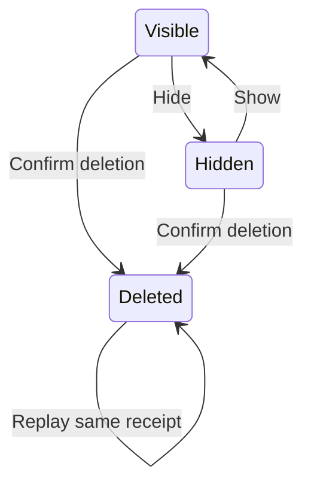
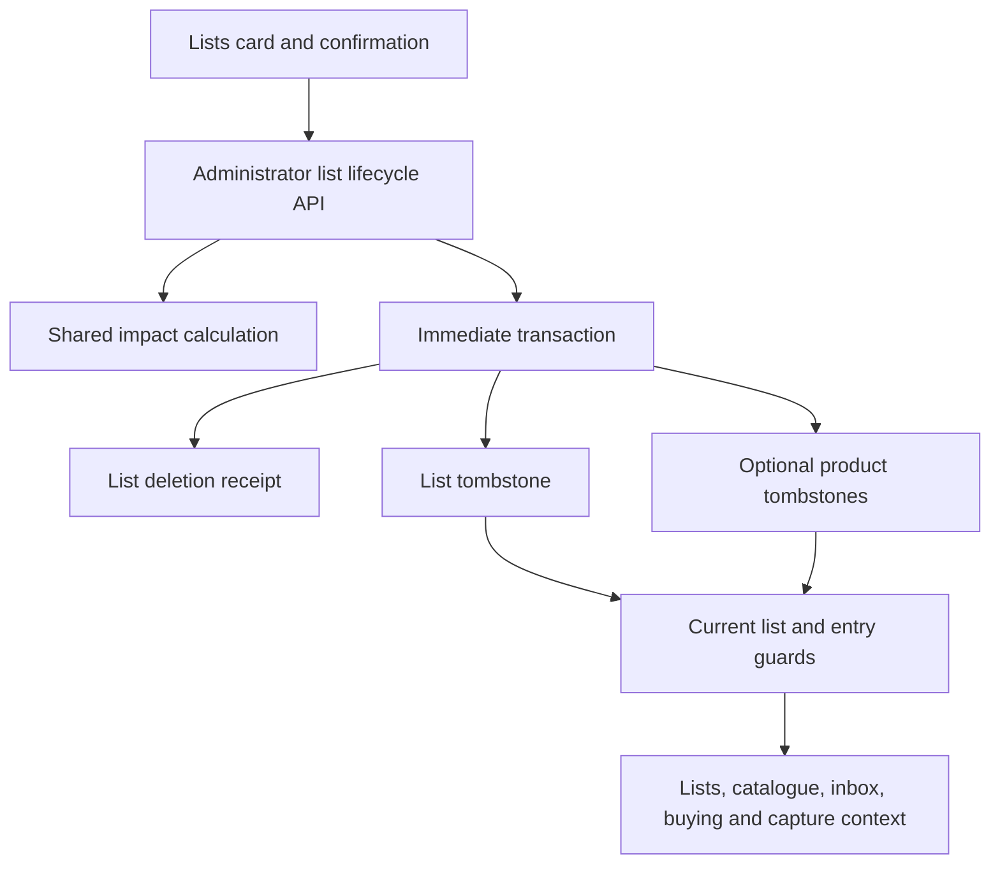
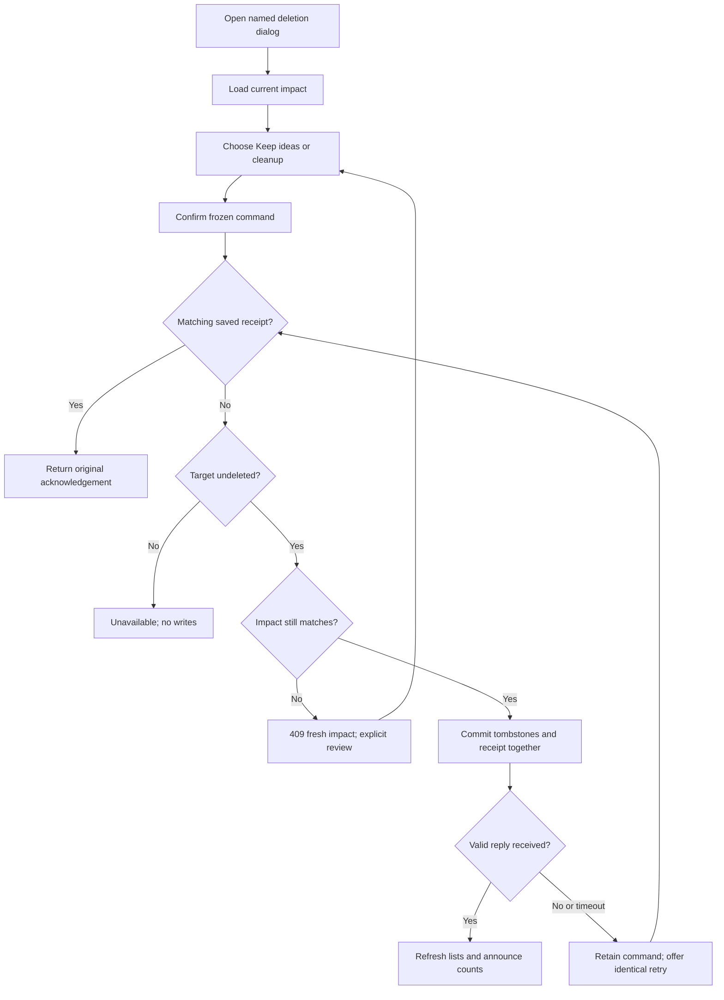

# List Lifecycle - Plan

## Goal Capsule

- **Objective:** The administrator can clear unwanted lists from Gift lists and choose whether to keep their remaining ideas.
- **Means:** Extend existing hiding and product tombstones with a separate list-deletion operation (KTD1–KTD3).
- **Authority:** The requested list-page controls govern scope; the existing household access, buying, capture and catalogue Undo contracts remain binding through R4–R8.
- **Execution profile:** One cohesive local feature, with a shared foundation before service, visibility and UI work. This session does not create a PR, Jira ticket, remote or deployment.
- **Completion owner:** The implementing workflow completes the units, isolated verification and local review.
- **Stop conditions:** Stop for evidence that deletion cannot retain buying history, migration cannot preserve existing rows, or a necessary live-data action exceeds the session's authority. Deferred naming and layout details do not block implementation.

---

## Product Contract

### Summary

Put Hide, Show and Delete controls on the Gift lists page for the administrator. Deleting a list keeps its ideas by default, with an explicit option to delete ideas that this deletion leaves without another list.

### Problem Frame

The lists index only opens lists; its existing archive control is inside each list. Administrators cannot remove obsolete lists from the application or deal deliberately with their remaining ideas.

### Requirements

**List controls**

- R1. The administrator can hide and show individual lists directly from the lists index. Normal viewing excludes hidden lists, and an administrator-only Show hidden lists control reveals them for restoration.
- R2. Hiding remains reversible and excludes the list from relatives' access using the existing archived-list behaviour. It retains ideas, memberships, grants and buying history.
- R3. The administrator can delete a visible or hidden list through a confirmation naming that list and its recipient. Keep ideas is the default; optional cleanup deletes only live ideas belonging to the target list that have no other undeleted list, including hidden lists. Previously unlisted ideas and already deleted ideas are untouched.

**Visibility and preservation**

- R4. Deleted lists disappear from all current list context, entries, totals, buying actions, invitations, capture destinations and editing memberships, including for the administrator. Hide/Show cannot restore a deleted list.
- R5. Deletion retains list memberships, per-list buying values, allocation history, photographs and existing operation receipts privately. Shared ideas remain accessible through their other current lists; kept ideas with no current memberships retain the existing administrator catalogue and author-inbox behaviour.
- R6. A deleted recipient/occasion list can be recreated with a new identity. Existing invitations and grants for the deleted identity never grant access to its replacement; hidden lists still reserve their recipient/occasion combination.
- R7. Existing catalogue Undo keeps its current meaning and cannot restore a deleted list or erase its retained memberships. The new list-deletion confirmation and success message do not promise list Undo.

**Confirmation and failure handling**

- R8. Only a freshly authorised administrator can mutate list lifecycle state. Before deletion, confirmation shows affected live idea counts, the optional cleanup count, and the list's reservations/purchases; a relevant membership or buying change requires fresh review before any deletion commits.
- R9. Cancellation before submission writes nothing. A lost, stalled or invalid response leaves a truthful recoverable pending action with a bounded wait and identical retry; an acknowledged successful deletion is never applied twice.

### Key Decisions

- **Keep ideas unless cleanup is explicitly chosen.** Limits an accidental list deletion's effect. Governs R3, R5.
- **Reuse hiding and retain deleted records.** Preserves the existing household and buying contracts. Governs R2, R4–R7.
- **No new list Undo or trash manager.** The request is served without changing the catalogue's recovery model. Governs R7.

### Acceptance Examples

- AE1. **Covers R1, R2:** Hide a birthday list from its card. A relative loses list access; Show hidden lists lets the administrator show that same list again with its buying state intact.
- AE2. **Covers R3, R5:** Delete a list with Keep ideas selected. Its ideas remain in the catalogue, and an author's newly unlisted idea appears in their inbox.
- AE3. **Covers R3, R5:** Delete a list containing one unique idea, one shared with a visible list and one shared only with a hidden list, selecting cleanup. Only the unique idea is tombstoned; a pre-existing unlisted idea is unchanged.
- AE4. **Covers R4, R6:** Follow an old deleted-list URL and its buying link, then recreate the same recipient/occasion. Old links and invitations remain unavailable; the new list has a different ID.
- AE5. **Covers R8, R9:** Another tab reserves an idea or changes whether it is shared after preview. Confirming changes nothing and displays fresh impact for explicit reconfirmation.
- AE6. **Covers R7, R9:** A deletion commits but its reply is lost. Reload and retry the saved operation; the original acknowledgement returns once, and no message suggests that catalogue Undo restores the list.

### Scope Boundaries

No permanent purge, media cleanup, generic workflow engine, extra administrator roles, bulk list operations, new list search, multi-level Undo or redo. Current per-card controls and the existing hidden-list checkbox suit the tens-of-lists context.

Considered and not built: an offline list-mutation queue, because these administrative destructive actions require fresh server impact; a separate trash browser, because retained tombstones and existing backups provide preservation without a new user-facing lifecycle; hard deletion, because restrictive references and buying history make it unsafe here. Revisit these only with a specific recovery or retention request.

---

## Planning Contract

### Assumptions

- The supplied implementation brief's defaults are accepted for this bounded extension: Hide uses existing archive semantics, cleanup concerns newly orphaned ideas only, and deleted lists are not restored through current controls. These are working defaults, not additional user-confirmed provenance claims.
- Keep hidden-list behaviour for administrator inspection and existing buying transitions; deletion is the stricter state. Hidden memberships still count as current memberships for orphan and author-inbox decisions.
- Recoverable orphan deletion means existing product tombstones with retained records and backup recovery. It does not create a new latest catalogue Undo action or a new restoration UI.
- All feature tests use isolated temporary fixtures and a unique browser-server port. The implementation owner has separately established the live migration barrier described under Sequencing; planning performs no database writes or runtime probes.

### Key Technical Decisions

- KTD1. **Use separate hidden and deleted state.** Keep `lists.archivedAt` and its absolute `{ archived: boolean }` PATCH contract. Add nullable `lists.deletedAt`; all current list readers reject it before administrator shortcuts. Explicit list DTO projection omits the internal marker. Implements R1, R2, R4.
- KTD2. **Use one additive migration for persistence.** Add the list tombstone and a small list-deletion receipt table with actor/operation uniqueness, canonical request fingerprint, stored acknowledgement and timestamp. Replace both recipient/occasion uniqueness predicates with their undeleted equivalents, retaining their null/non-null occasion split. Update the duplicate precheck too. Implements R5, R6, R9.
- KTD3. **Keep deletion receipts separate from catalogue Undo.** Existing `catalogue_actions` constrains kinds to add/delete/undo and drives a latest-product-action pointer. A separate bounded list service avoids widening that recovery protocol. Apply product `deletedAt`/`deletionToken` only to R3 candidates, using the list operation's token, and retain raw entries/history. Existing add Undo must reject any deleted target list; product-delete Undo retains full snapshot checks and never changes list liveness. Implements R3, R5, R7, R9. A competing ledger redesign does not warrant a bake-off: the existing contract already fixes the relevant boundary.
- KTD4. **Preview and commit share one impact calculation.** Fingerprint list identity/state, target live product IDs, their relevant memberships on undeleted lists, and target-list entry buying state/version and values. Include all current target-list buying consequences even for Keep ideas. The commit uses an immediate transaction to refresh administrator identity, replay an existing matching receipt before checking target liveness, recalculate impact, compare approval, apply tombstones and record the acknowledgement atomically. Relevant changes return a typed 409 with fresh impact and no mutations. Implements R3, R8, R9.
- KTD5. **Treat historical membership separately from current membership.** Join undeleted lists in public entries, author-inbox existence checks and product membership authorisation. Limit product PATCH's replacement/removal set to undeleted-list entries, preserving hidden-list rules. Never remove historical entries as a side effect of an ordinary edit. Implements R4, R5, R7.
- KTD6. **Reuse the small local request and dialog patterns.** Use native dialog plus `containDialogFocus`, separate card links from action buttons, and return focus to a persistent list-status region if its card disappears. One page-level administrator controller outside the card loop owns the actor-scoped sessionStorage pending command, frozen payload and UUID, as in `CatalogueActions.svelte`. Obtain verified administrator identity from list page data before preview, so reload can replay a deleted target's saved command without mounting its card or obtaining fresh impact first. Validate acknowledgements before clearing pending state. Bound fetch plus body reading with the existing 12-second request pattern. Hide/Show retries the same absolute desired state rather than toggling. Implements R1, R8, R9.

### High-Level Technical Design

Lifecycle:

Component and data flow:

Confirmation protocol and decision points:

### API Boundary

Add a dedicated administrator-only deletion-impact read below `/api/lists/[id]`, and DELETE on the existing list resource. Shared lifecycle types own the preview, request, acknowledgement and conflict shapes. The command contains a UUID operation ID, cleanup choice and reviewed impact fingerprint; its canonical fingerprint also binds the target list ID. Acknowledgement names the operation, deleted list and effective idea counts, without returning raw buying history or tombstone records.

Successful same-operation replay returns stored acknowledgement after fresh administrator authentication. A different payload reusing that UUID conflicts. Missing/deleted targets are unavailable for a fresh operation; changed impact is a distinguishable 409 requiring review. Same-origin checks and private no-store responses follow current API helpers. Keep existing GET and archive PATCH consumers compatible.

### Existing Behaviour and System-Wide Impact

`access.ts` owns current lists, entries, author fallback and media projection. `catalogue.ts` has both a raw inbox-membership existence query and product PATCH's raw replacement membership set. `allocations.ts`, `totals.ts` and `invitations.ts` have existence or archived-only SQL checks that must independently reject deletion. Filter deleted grants from people settings output while preserving stored associations.

`capture-sync.ts` replays a stable minimal receipt before saving new capture data. Preserve that ordering: old receipts acknowledge already committed work without restoring memberships; fresh stale destinations fail through the existing editable-draft path. `enrichment/jobs.ts` already delegates product access to `canReadProduct` before work, paid dispatch and result commit. Orphan product tombstones revoke those paths; kept or shared live ideas remain eligible under current access rules. Do not disable enrichment simply because a live idea once belonged to the deleted list.

### Sequencing and Risks

U1 owns schema and shared contract creation. After U1, U2 and U3 own disjoint service and visibility files. U4 can author its unimported component and browser fixture against that fixed contract in parallel. Attaching the DELETE export and live index controls waits for completion of U2's service/route preparation and U3's guards; only that publication tail is gated. U5 verifies their integration.

The main risks are a missed raw membership query, loss of retained history during product editing, stale orphan approval and a typed-schema reload before migration. First prove the migration on an isolated copy of the previous schema. The implementation owner's separately authorised live transition requires a verified backup before applying the additive migration and before any running process loads the changed typed list schema. Do not use a destructive down migration or perform feature tests on family data.

### Sources and Research

Current local source is authoritative: `src/lib/server/access.ts`, `catalogue.ts`, `catalogue-actions.ts`, `capture-sync.ts`, `allocations.ts`, `totals.ts`, `invitations.ts`, `enrichment/jobs.ts`, `db/schema.ts`; `src/lib/components/CatalogueActions.svelte`; `src/lib/dialog-focus.ts`; `drizzle/0004_catalogue-actions.sql`; `package.json`. These provide the behaviour trace and reusable transaction, replay, tombstone and UI patterns.

The existing recovery contract is recorded in `docs/plans/2026-11-09-0030-feat-catalogue-list-actions-plan.md`. This extension preserves that feature rather than reopening it. No external research or provider calls are needed for this local pattern extension.

### Deferred / Open Questions

No launch-blocking user decision remains. Exact helper/component names and final impact DTO labels can be chosen during implementation within KTD1–KTD6.

---

## Implementation Units

### U1. List tombstones, receipt persistence and shared contract

**Goal:** Establish the shared foundation for R4–R6, R8, R9 through KTD1, KTD2 and KTD4.

**Dependencies:** None.

**Files:** `src/lib/server/db/schema.ts`; new `drizzle/0005_list-lifecycle.sql`; `drizzle/meta/_journal.json`; new `src/lib/shared/list-lifecycle.ts`; `src/lib/server/access.ts` list DTO boundary, handed to U3 after foundation; existing migration fixture home `tests/integration/catalogue-model.test.ts`.

**Approach:** Define one receipt/impact contract and additive migration. Keep new fields internal to persistence and introduce explicit DTO projection at the schema boundary so inferred `GiftList` does not expose deletion markers. Update both unique predicates; U3 owns the matching application creation precheck.

**Patterns to follow:** SQL/journal migration from `0004_catalogue-actions.sql`, existing nullable product tombstones and inferred projection DTOs.

**Execution note:** Establish isolated previous-schema upgrade proof before any changed typed schema is loaded by a family instance.

**Test scenarios:**

1. Upgrade a previous-schema fixture with current/hidden lists, general and named occasions, memberships and buying history; old rows and foreign keys remain intact.
2. Delete one occasion/general list in the fixture and recreate its recipient/occasion; hidden or other undeleted duplicates remain rejected.
3. Both fresh and upgraded databases accept the receipt contract; duplicate actor/operation storage cannot produce two receipts.
4. API list projections omit the internal deletion marker and preserve the existing client-visible shape.

**Verification:** Migration and model integration fixtures prove storage compatibility. This seam proves persistence, not browser accessibility or live migration readiness.

### U2. Atomic administrator list deletion

**Goal:** Implement R3, R5, R8, R9 through KTD2–KTD4.

**Dependencies:** U1 for service and route preparation; U3 before attaching the live DELETE export.

**Files:** New `src/lib/server/list-lifecycle.ts`; `src/routes/api/lists/[id]/+server.ts`; new `src/routes/api/lists/[id]/deletion-impact/+server.ts`; new `tests/integration/list-lifecycle.test.ts`.

**Approach:** Give one service ownership of impact calculation and the deletion transaction. Implement KTD4 with bounded response shapes and exact receipt replay; avoid routing internal deletion through an HTTP product action or its latest-action pointer. Author the service and route files first, but attach the resource's live DELETE export only after U3 guards are ready. U3 owns archive mutation and the creation precheck.

**Patterns to follow:** `catalogue-actions.ts` immediate transactions and fingerprints; `http.ts` same-origin, private responses and access errors.

**Test scenarios:**

1. Covers AE2. Keep ideas deletes only the list marker and stores one acknowledgement; all products and raw history stay unchanged.
2. Covers AE3. Cleanup of unique/shared/hidden-shared/already-deleted candidates deletes exactly the current unique live subset and leaves a pre-existing unlisted idea intact.
3. Covers AE5. Target membership, another current membership, reservation, purchase, release or list-state change after preview produces fresh conflict impact and no partial effects, including Keep ideas.
4. Covers AE6. Same actor/UUID/payload replays after target deletion; changed cleanup choice, list ID or approval under that UUID conflicts.
5. Signed-out, revoked, buyer/contributor/viewer and cross-origin mutation attempts fail without changes or impact leakage.
6. Empty and already hidden lists can be deleted; a fresh operation against a missing/deleted target cannot restore or affect it.
7. An injected receipt-write failure rolls back the list and all product tombstones together.

**Verification:** Handler/service integration asserts both public replies and raw fixture state. It proves transactional deletion and authorisation; UI retry persistence is U4.

### U3. Enforce current-list boundaries without losing history

**Goal:** Implement R2, R4, R5 and R7 through KTD1, KTD3 and KTD5.

**Dependencies:** U1; exercise with U2 once available.

**Files:** `src/lib/server/access.ts` after U1's DTO handoff; `src/lib/server/catalogue.ts`; `src/lib/server/catalogue-actions.ts`; `src/lib/server/allocations.ts`; `src/lib/server/totals.ts`; `src/lib/server/invitations.ts`; `src/lib/server/people-api.ts` only if its projection needs changes; `src/lib/server/capture-sync.ts` and `src/lib/server/enrichment/jobs.ts` only where the access audit requires changes; new `tests/integration/list-lifecycle-boundaries.test.ts`; existing `catalogue-access.test.ts`, `catalogue-deletion-visibility.test.ts`, `allocations.test.ts`, `totals.test.ts`, `invitations.test.ts`, `capture-sync.test.ts`, `catalogue-actions.test.ts`, `enrichment.test.ts` and `media-revocation.test.ts` under `tests/integration/`.

**Approach:** Audit the named raw list/entry seams and apply KTD5 at shared readers and independent write boundaries. Own the archive PATCH deleted-target guard and the list creation duplicate precheck here. Supply verified administrator identity in list page data for KTD6's actor-scoped recovery, without exposing it as a non-administrator capability. Keep all old fixture expectations. Reject unsafe reverse-add Undo rather than deleting saved memberships on a deleted list; leave unrelated valid catalogue Undo working.

**Test scenarios:**

1. Covers AE4. For administrator and each relative role, deleted list detail/totals/allocation reads and writes fail; index, identity, people settings and buying context omit its entries/grants.
2. Covers AE2. Keeping an idea on its only deleted list makes it unlisted in the author's inbox and readable by that author, without granting another relative access.
3. Shared ideas remain visible through authorised current lists; hidden current membership prevents author-inbox fallback and protects cleanup.
4. Edit a shared or kept idea after deleting a list with an available and a purchased historical entry; both raw entries and allocation history remain unchanged and ordinary edits succeed.
5. Fresh capture or catalogue-add targets using a deleted list are rejected; old capture receipt replay stays a minimal acknowledgement and does not recreate entries.
6. New invitations/grants and acceptance of a pending invitation with any deleted target fail atomically; replacement-list identity inherits no old access.
7. Catalogue add Undo involving a deleted list conflicts without removing retained rows; unrelated Undo and product-delete Undo preserve their contract without restoring the list.
8. Orphan tombstones revoke media, duplicate projection and queued/confirming enrichment access using local provider fakes; kept/shared live ideas remain usable.
9. Hide/Show preserves existing administrator inspection and buying behaviour, while all non-administrator hidden-list paths remain denied.

**Verification:** Cross-surface integration exercises existing handlers and checks raw historical preservation. Provider fakes and fixture media prove local permission boundaries only.

### U4. Accessible per-card lifecycle controls and reliable confirmation

**Goal:** Deliver R1–R3, R7–R9 through KTD6.

**Dependencies:** U1 for component and fixture authoring; U2 and U3 before attaching live controls.

**Files:** `src/routes/lists/+page.svelte`; `src/routes/lists/[id]/+page.svelte`; `src/routes/products/[id]/+page.svelte` and `src/lib/components/IdeaCollection.svelte` for hidden terminology only; new focused list lifecycle component under `src/lib/components/`; `src/lib/dialog-focus.ts` only if reuse requires a compatible extension; `src/app.css` only for necessary card/dialog styling; new `tests/e2e/list-lifecycle.spec.ts`.

**Approach:** Keep Open as an ordinary link inside a card container and put administrator actions alongside it. Preserve recipient/occasion in the link's accessible name for existing navigation and browser contracts. Rename archived terminology consistently to hidden, including product badges and collection filters. Distinguish all-lists-hidden from no lists, retaining an obvious Show hidden lists route. Mount KTD6's controller outside card iteration so it survives an empty index and can recover an absent target after reload. Wire the native confirmation to U2's preview; a changed-impact response returns to explicit review instead of silently resubmitting. Success refreshes the index and uses truthful list/idea counts.

**Patterns to follow:** `CatalogueActions.svelte` pending requests and bounded body reading; existing native dialogs and `containDialogFocus`.

**Test scenarios:**

1. Covers AE1. From the index Hide then Show the same list through Show hidden lists; verify relative access and preserved buying state. Hiding the last visible list shows an all-hidden message and a working Show hidden lists control.
2. Covers AE2, AE3. Confirm default Keep ideas and explicit cleanup on mixed fixtures; displayed names/counts match the resulting catalogue.
3. Cancel or Escape before submission writes nothing; menu controls do not activate the card link, and keyboard focus is contained and restored logically after card removal.
4. Covers AE5. Stale buying/membership impact changes the preview, preserves the administrator's choice, and requires another explicit confirmation.
5. Covers AE6. Lost reply, indefinitely stalled response body and reload retain the frozen command; retry sends the identical UUID/payload and clears pending state only on a matching acknowledgement. After server commit and reload, recovery remains available even though the deleted card is absent and its preview would be unavailable.
6. HTTP validation/conflict responses, non-JSON responses and expired identity produce useful bounded status; another account cannot replay the previous actor's pending command.
7. Mobile-width cards retain usable Open, Hide/Show and Delete controls; relatives see no administrative affordances.
8. List deletion success copy never promises catalogue Undo, including when the catalogue has a newer action in another tab.

**Verification:** Isolated browser tests cover interaction, network ambiguity and server effects. They do not establish physical Android/iOS or home-server acceptance.

### U5. Integration proof, backup preservation and documentation

**Goal:** Verify R1–R9 together and retain the prior recovery contract.

**Dependencies:** U2–U4.

**Files:** `tests/integration/backup-restore.test.ts`; `tests/e2e/list-lifecycle.spec.ts`; `tests/e2e/catalogue-actions.spec.ts` for any new cross-feature regression; `README.md`; `docs/backup-restore.md`; `docs/deployment.md` only for additive migration guidance.

**Approach:** Extend the isolated backup fixture with hidden/deleted lists, retained bought entries, product tombstones and a list receipt. Document the distinction between hidden and deleted, the default cleanup choice and R7's recovery limit. Review the combined feature diff and remove abandoned approaches.

**Test scenarios:**

1. Backup and restore an isolated fixture; hidden/deleted markers, raw memberships, purchases, history, photographs and operation receipts match, while existing access-reset expectations remain intact.
2. Re-authenticate the restored fixture administrator and verify deleted lists remain unavailable and a matching stored deletion operation acknowledges without reapplying effects.
3. Run the original catalogue Undo browser journey alongside the new lifecycle journey; list deletion neither replaces its action pointer nor revives a deleted list.

**Verification:** Existing quality gates pass once the integrated feature is stable. Backup proof is isolated and does not itself authorise touching the family database.

---

## Verification Contract

Use the repository's existing `check`, `lint`, `test:unit`, `test:integration`, `build` and `test:e2e` package scripts; `verify` composes them. Run focused new regressions while implementing, then the complete existing suite once integrated. Preserve all current tests and investigate failures against the fixed task baseline rather than weakening them.

All database/media tests and migration/backup proofs use temporary fixture roots. Browser work uses a unique port and fixture-local paths, never the family server or real sign-in/provider/GCP calls. Do not claim a planning read or a passing local fixture proves live deployment or physical-device behaviour.

U1 proves old-schema upgrade and unique-index semantics. U2 proves atomic effects and replay. U3 proves no deleted-list exposure or historical loss across existing handlers. U4 proves accessible controls and bounded request recovery. U5 proves their combined backup and catalogue Undo compatibility.

---

## Definition of Done

The administrator can hide, show and delete lists from the index with the R3 default and optional cleanup. The implementation passes every unit's verification and the integrated quality gates. All identified current-list boundaries exclude deleted lists, and retained records survive ordinary edits and isolated backup/restore. List recreation uses a fresh identity without old access. Cancellation, stale approval and unknown responses have the specified truthful outcomes. Documentation explains the recovery limit, and abandoned code or experimental artefacts are absent from the feature diff.
