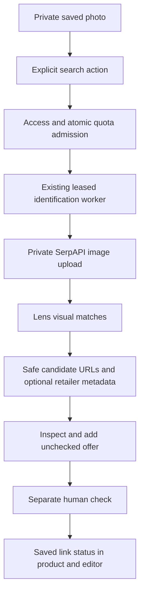
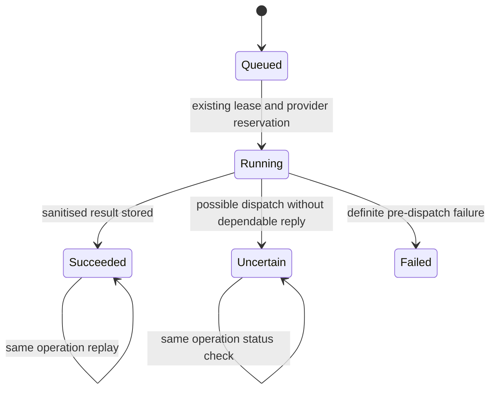
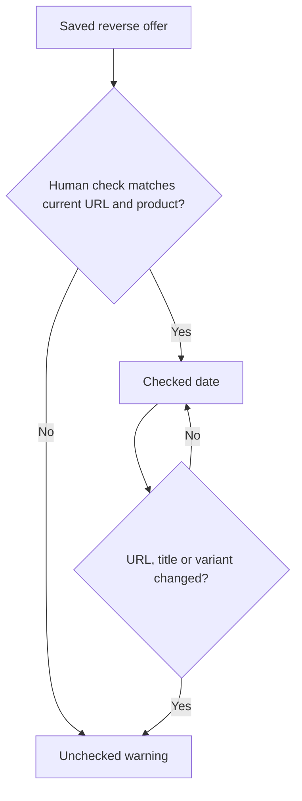

# Photo Shopping Links - Plan

## Goal Capsule

- **Objective:** A parent can find a place to buy an item they photographed and see whether a person has checked the suggested link.
- **Means:** Product-scoped SerpAPI Google Lens search and recorded human checks (KTD1–KTD4).
- **Authority:** The requested photo-to-buying-link flow and the chosen provider govern scope; existing household permissions and capture contracts remain binding through R7–R9.
- **Execution profile:** One cohesive local change with foundation before parallel service and interface work. Local commits only, with no remote, PR, Jira ticket or GCP change.
- **Completion owner:** The implementing workflow owns integration, verification and final review.
- **Stop conditions:** Stop provider dispatch if credentials, quota, access or documented upload support are unavailable. Keep the saved idea usable and report the precise setup gap.

---

## Product Contract

### Summary

After saving a photographed idea, offer Find where to buy. Show possible purchase pages, let the administrator inspect and add one, and keep a clear warning until they explicitly check that page against the product and variant.

### Problem Frame

Photo extraction can describe an item but does not find an evidenced buying page. Existing shopping links also carry no durable distinction between an image-search suggestion and a link someone checked.

### Requirements

**Finding a purchase page**

- R1. A saved idea with a photo offers an explicit Find where to buy action, also reachable from the capture success screen.
- R2. The action discloses that a compressed copy of the selected photo goes to SerpAPI and Google; the original stays private in the app.
- R3. Results contain actual public HTTPS destination links returned by the provider, labelled as possible matches rather than exact identifications.
- R4. The administrator can inspect and add a selected result as an unchecked shopping link without replacing the original photo, source or manual details.

**Human checking**

- R5. Every unchecked reverse-found link shows a nearby warning that it may be incorrect, including saved links, their editor and result evidence.
- R6. A separate administrator action records a human check of the exact current URL and product identity; opening or adding a result alone never establishes that check.
- R7. Changing a checked URL or the product's title or variant makes the reverse-found link unchecked; ordinary price edits retain its provenance and compatible check.

**Existing contracts and failure handling**

- R8. Existing administrator-only offer changes and checks remain in force; contributors may request matches only under the current capture-and-product-read permission boundary.
- R9. Offline capture, direct retailer metadata, list estimates, catalogue Undo and backup recovery retain their existing meaning.
- R10. Each admitted search consumes one of this app's monthly slots before dispatch; rechecking the same operation never repeats a potentially completed provider search.
- R11. Missing setup, quota exhaustion, no matches and uncertain results leave the saved idea intact with an actionable status and no automatic provider fallback.

### Key Decisions

- **Search after saving.** The existing offline photo flow remains the entry point. Governs R1, R9.
- **Adding is distinct from checking.** A chosen result can still be wrong. Governs R4–R7.

### Acceptance Examples

- AE1. **Covers R1–R6:** Save a shop photo, search it, inspect a possible shop page and add it. Another reader still sees the warning until the administrator explicitly checks the product and variant.
- AE2. **Covers R5–R7:** Reload or edit only a price after checking a link; its check survives. Change its URL or the product variant; the warning returns.
- AE3. **Covers R8, R10, R11:** A response is lost after a completed search. Retrying its saved operation returns the stored result without another provider request; a different account cannot reuse its mutation authority.

### Scope Boundaries

No automatic purchasing, price monitoring, background/offline search queue, public photo hosting, new roles, provider switching or redesign of the existing enrichment worker. Search results may be similar products or non-shopping pages; no exact-match or seller-safety guarantee is made. A separate seller-verification system is not built because the requested human product/link check does not establish seller reliability.

---

## Planning Contract

### Assumptions

The human check attests that the administrator inspected the linked product and variant, not that price or stock will remain current. The UTC calendar-month app counter is independent of SerpAPI's account renewal cycle and usage by other applications. At planning time, the supplied key had passed an account-only check: Free Plan, 250 searches remaining at that check. Implementation subsequently exercised one public image upload and Lens search; see the [live evaluation](../evaluations/2026-11-14-photo-shopping-links.md).

### Key Technical Decisions

- KTD1. **Use SerpAPI's documented private image upload and Lens visual matches.** Send a metadata-stripped JPEG, PNG or WebP below 500,000 bytes to the Image API, then use its returned image identifier in one synchronous Lens query with UK localisation. The documented identifier expires after ten minutes; that is not a deletion promise. Do not use the discontinued products subtype. This implements R1–R3 and R11. (session-settled: user-directed — chosen over Google Cloud Vision after considering extra billing/credential setup and sharing the photo with SerpAPI and Google.) Bind to the [Image API](https://serpapi.com/image-api), [Lens upload guide](https://serpapi.com/google-lens-upload-an-image), [visual matches](https://serpapi.com/google-lens-visual-matches-api) and [privacy policy](https://serpapi.com/legal).
- KTD2. **Extend the existing identification job pipeline.** Pin the provider on each queued `lookup_jobs` row, defaulting old callers and records to the existing Vision provider. Honour stored legacy fingerprints without a provider only for legacy/default Vision and metadata operations; never reinterpret one as SerpAPI. New photo searches explicitly select SerpAPI and bind it in their fingerprint. Reuse the existing actor/operation identity, product/photo fingerprint, leases, access rechecks, result storage and uncertain-dispatch recovery. Add only a job-keyed SerpAPI reservation table: a short immediate transaction reserves one UTC-month slot before external work. `SERPAPI_API_KEY` stays server-side; `SERPAPI_MONTHLY_SEARCH_LIMIT` defaults to 200, below the currently advertised 250-search free plan. Preserve uncertain reservations and require an explicit new operation for another provider attempt. This implements R8, R10 and R11; it is a search-count control, not an account-wide monetary cap. Bind to [SerpAPI pricing](https://serpapi.com/pricing).
- KTD3. **Store reverse origin and checks on offers, owned by the server.** New reverse offers start unchecked. Keep the internal checking actor and time, plus a fingerprint of the canonical URL and product title/variant. Publish only the small status/date projection needed by readers. Preserve origin independently of price changes and reject client-asserted checks. Reconciliation accepts an owned stable offer ID, with canonical-URL compatibility for old clients; changing the URL retains reverse origin but clears the check. Duplicate URLs cannot downgrade an existing reverse origin. Recognise legacy Vision-created offers only through their exact generated IDs and trusted job/product association. This implements R4–R8.
- KTD4. **Bind selection and checking to reviewed state.** The existing successful job ID and candidate index identify the proposed destination. Reuse administrator suggestion confirmation for idempotent offer acceptance; it never marks a link checked. A human-check request includes the reviewed URL and product-identity fingerprint; an immediate transaction freshly authorises and rejects stale approval. The administrator can also mark a link unchecked again. This implements R4, R6–R8.
- KTD5. **Keep provider data provisional and bounded.** Use only visual-match destination `link` fields, not thumbnails, archive URLs or provider follow-up endpoints. Deduplicate and retain at most six safe candidates. Prefer plausible UK retailer pages and enrich at most three through the existing SSRF-safe public fetcher; blocked pages retain an unchecked link and unknown price. Do not adopt an unrelated off-site offer URL from page metadata. Preserve original currency, observation time and uncertainty, and do not seed authoritative list estimates from unchecked search prices. This implements R3–R5 and R9.
- KTD6. **Reuse existing access and request-recovery patterns.** Verify the live readable product, selected photo ownership and current actor before each external stage and final storage. Preserve and recheck the existing identification-enabled setting before provider dispatch; disabled or restored-disabled settings stop new Lens work without being automatically overridden. Bind pending UI work to the original actor/product/photo and retain its operation across reload or navigation. Bound fetch and body reading; a completed job replays, while queued, running or uncertain jobs report their state without another dispatch. Keep credential-bearing provider URLs, raw errors, account responses and input-image references out of logs, persisted results and public DTOs. This implements R2, R8, R10 and R11. Lens uses documented server-side HTTPS GET/query-key authentication; do not invent a POST-search or Bearer contract.

### Shared Foundation Contract

U1 owns the migration, shared types, provider field and existing offer write/read seams. After that foundation handoff, U2 owns further job-service changes. Freeze these before other units author against them:

- Search request: the existing identification operation UUID and image kind, plus an explicit SerpAPI provider and selected attached photo ID. Include the pinned provider in new request fingerprints, retain the restricted legacy compatibility in KTD2, and reject provider overrides on metadata-only jobs.
- Search status/result: reuse the existing public job/result types, adding provider identity and safe SerpAPI configured/used/limit/remaining status. Existing job ID plus candidate index is the stable selection identity. Candidates carry a destination URL, title, retailer/domain, optional supported price/currency and uncertainty. Internal provider image IDs, request URLs and raw responses are not client fields.
- Add request: reuse the existing administrator confirmation payload with stored job ID, candidate index and the offer field selected. Its success remains compatible and the product reload exposes the existing or newly created unchecked offer.
- Check request: owned offer ID, desired checked state, reviewed canonical URL and product-identity fingerprint. Public offer data supplies the review fingerprint and reverse/check status/date; raw checker identity remains internal.
- Editable shopping drafts may carry an optional owned offer ID and read-only reverse/check display fields. The server parses only permitted edits and derives all trust state itself.

### High-Level Technical Design

### Sequencing and System-Wide Impact

U1 lands first. U2 owns the new provider/service/routes; U3 can author its unimported interface against the frozen contract in parallel. Attach live controls only after U1's provenance boundaries and U2's guarded routes are ready. U4 owns final integration and recovery evidence.

Before the running family instance loads changed typed offer columns, prove the additive migration on an isolated prior-schema fixture, make and verify a private backup, and apply the live migration under the implementation owner's control. Never feature-test against household data. Existing generic suggestion confirmation must invalidate incompatible checks when it changes title or variant, and derive legacy reverse origin from the trusted job kind.

### Research That Shapes This Plan

Existing patterns are in `src/lib/server/enrichment/jobs.ts`, `gemini.ts`, `fetch.ts`, `src/lib/server/catalogue.ts`, `access.ts`, `src/lib/catalogue-types.ts`, `ProductSuggestions.svelte` and `CaptureEditor.svelte`. `setDetails` currently rebuilds offers, making provenance preservation a required change. Backup already copies the complete SQLite database; no new archive format is needed. Gemini search grounding was rejected for this catalogue flow after its storage/collection restrictions were examined; existing Gemini extraction remains unchanged. The selected SerpAPI mechanism needs one direct upload and one query, so a competing architecture bake-off would not settle an open choice.

### Deferred to Implementation

Choose final helper names, reservation fields and timeout values within KTD2–KTD6. The account-only key check has passed; validate one non-personal image upload/search during implementation; distinguish fixture success from actual useful matches. SerpAPI plan exhaustion must remain a visible setup/provider outcome, never a paid fallback.

---

## Implementation Units

### U1. Persist search identity and trusted offer checks

**Goal:** Establish the shared contract and preserve reverse-link provenance through every existing offer path.

**Requirements:** R4–R10; KTD2–KTD4.

**Dependencies:** None.

**Files:** New `drizzle/0006_photo-shopping-links.sql`; `drizzle/meta/_journal.json`; `src/lib/server/db/schema.ts`; `src/lib/server/db/enrichment-schema.ts`; `src/lib/server/enrichment/types.ts`; new `src/lib/shared/photo-shopping-links.ts` and `src/lib/server/offer-review.ts`; `src/lib/server/access.ts`; `src/lib/server/catalogue.ts`; `src/lib/server/catalogue-actions.ts`; `src/lib/catalogue-types.ts`; `src/lib/server/enrichment/jobs.ts`; new `tests/integration/photo-shopping-model.test.ts` and `tests/integration/photo-shopping-provenance.test.ts`.

**Approach:** Create provider pinning, count reservations and offer fields, then publish explicit DTOs and the frozen shared contract. Extend owned-ID/canonical-URL reconciliation under KTD3. Cover title/variant changes from both ordinary edits and existing suggestion confirmation. Keep the new UI and routes unattached until the migration barrier is satisfied.

**Test scenarios:**

1. Upgrade a prior-schema fixture without changing products, lists, purchases or manual offers; fresh and upgraded databases support the new constraints.
2. A proven legacy Vision offer becomes reverse/unchecked; ordinary metadata and unrecognised legacy IDs are not guessed to be reverse matches.
3. A reverse offer remains reverse through price edits, old-client payloads and duplicates; URL or product-identity changes clear a prior check.
4. Submitted checker/origin flags and foreign offer IDs cannot forge or erase trusted state; normal readers receive no internal checker or provider fields.
5. Adding an idea to another list does not initialise its estimate from an unchecked reverse-search price; ordinary manual-offer fallback remains compatible.

**Verification:** Migration and reconciliation integration fixtures establish stored semantics, not live migration readiness. Start with failing behavioural regressions at these boundaries.

### U2. Implement private Lens search and exact-link review actions

**Goal:** Run the selected provider through existing identification jobs and expose a separate exact-link check action.

**Requirements:** R2–R4, R6, R8, R10, R11; KTD1–KTD6.

**Dependencies:** U1.

**Files:** New `src/lib/server/enrichment/serpapi.ts`; a focused SerpAPI count-reservation helper under `src/lib/server/enrichment/`; `src/lib/server/enrichment/jobs.ts` after U1 handoff; `src/lib/server/enrichment/settings.ts`; a new exact-link check handler and `src/routes/api/products/[id]/offers/[offerId]/check/+server.ts`; existing identification routes only where their delegation needs updating; new `tests/integration/photo-shopping-links.test.ts` and `tests/unit/serpapi.test.ts`.

**Approach:** Add the SerpAPI adapter and reservation branch to KTD2's existing job worker and expose its safe configuration/status. Reuse existing candidate confirmation and metadata retrieval. Implement KTD4's new check handler without another search queue, polling protocol or acceptance endpoint. Publish the SerpAPI request choice after guarded service tests pass.

**Test scenarios:**

1. A fixture photo is re-encoded below the upload limit without original metadata, uploaded once and searched once with its image ID and UK parameters.
2. Real destination fields produce safe candidates; unsafe URLs, malformed success, absent results and unsupported price evidence never become invented offers.
3. Simultaneous admission respects the app cap; same-operation replay, lost replies and uncertain provider outcomes do not consume another external search. Existing queued/completed operations with legacy fingerprints still replay under their original provider, while an attempted SerpAPI override is rejected.
4. Revocation, product deletion or a photo from another product prevents dispatch/commit; disabling identification between queueing and dispatch prevents the external call; buyers/viewers cannot add or check links.
5. Covers AE1, AE3. Repeated add returns the same unchecked offer; explicit checking succeeds only for the currently reviewed URL and product identity.
6. Redirects, oversized/stalled bodies and key-bearing provider errors produce bounded redacted outcomes without a fallback provider.

**Verification:** Existing job handler/worker provider fakes prove local effects and exact requests. A limited real-provider smoke test with the supplied key is separate evidence.

### U3. Make inspection and human-check status clear

**Goal:** Deliver the photographed-idea flow and visible uncertainty without changing offline capture.

**Requirements:** R1–R9, R11; KTD3, KTD4, KTD6.

**Dependencies:** U1 for authoring; U2 before live attachment.

**Files:** New `src/lib/components/PhotoShoppingLinks.svelte`; `src/routes/products/[id]/+page.svelte`; `src/routes/capture/+page.svelte` success CTA only; `src/lib/components/CaptureEditor.svelte`; `src/lib/components/ProductSuggestions.svelte` for legacy reverse-result warnings and avoiding competing image-search prompts; new `tests/e2e/photo-shopping-links.spec.ts`.

**Approach:** Show one clear photo-search action with photo selection and disclosure. Display candidate domain, available price evidence and uncertainty beside the inspection link. Use distinct Add link and Mark checked controls, with a product/variant check explanation. Display saved status/date and a way to mark unchecked again; preserve warnings in the ordinary editor. Keep pending state bound to its original context under KTD6.

**Test scenarios:**

1. Covers AE1. Save a photo idea, follow the success CTA, search a fixture provider, inspect and add a link; the warning remains until the explicit human action.
2. Covers AE2. Check state survives reload and price editing, then resets after URL or variant editing; readers see the appropriate status without mutation controls.
3. Changing route/photo/account while a response is delayed cannot apply it to another idea; reload can recover the original operation.
4. Setup/quota/no-match/uncertain states preserve ordinary idea editing and use truthful actions; choosing a suggestion or opening its link does not mark it checked.
5. Keyboard and phone-width interaction keeps the photo, external inspection link, warning and confirmation controls usable.

**Verification:** Browser fixtures prove the user actions and resulting server state. They do not prove physical-device camera behaviour or match quality.

### U4. Verify recovery, document setup and evaluate the configured provider

**Goal:** Preserve the complete family-app contract and make provider readiness reviewable.

**Requirements:** R1–R11.

**Dependencies:** U1–U3.

**Files:** `tests/integration/backup-restore.test.ts`; `.env.example`; `compose.yaml`; `README.md`; `docs/backup-restore.md`; `src/routes/settings/identification/+page.svelte` to distinguish search counts from the existing USD allowance; focused fixtures/evaluation notes under `scripts/fixtures/` and `docs/evaluations/` where needed.

**Approach:** Prove the additive data survives real fixture backup/restore, document the selected service and its app-only cap, and run the repository quality gates. Pass both SerpAPI environment variables to the app and existing worker in Compose. Document starting the existing worker separately during local Vite development; the dev server alone does not run identification jobs. Keep the existing identification-enabled switch authoritative, including its disabled state after restore. Use only a bounded non-personal image for live evaluation with the supplied key. Remove abandoned provider experiments from the feature diff.

**Test scenarios:**

1. Restore a fixture containing checked/unchecked reverse offers, ordinary offers and completed/uncertain searches; their semantics survive while the existing session/access reset remains and restored-disabled identification prevents new Lens dispatch.
2. Existing capture, retailer metadata, catalogue Undo, list lifecycle, media revocation and estimate fixtures retain their assertions.
3. The configured provider can upload one public fixture image and return a Lens result or truthful no-match outcome without exposing credentials or household photos.

**Verification:** Run the existing check, lint, unit, integration, build and browser suites. Report actual provider eligibility and match evidence separately from local fixture passes.

---

## Verification Contract

Use `npm run check`, `npm run lint`, `npm run test:unit`, `npm run test:integration`, `npm run build` and `npm run test:e2e`. Run focused behavioural proofs during implementation, then the integrated suite once stable. All databases, media and browser servers used for feature checks are isolated fixtures. Preserve existing assertions; investigate failures against `f55769e` rather than weakening them.

The provider adapter tests establish upload/search contracts and redaction. U1 proves migration/provenance; U2 proves access, quota and action identity; U3 proves human-facing warnings and deliberate checking; U4 proves recovery and compatibility. Live evaluation uses the selected service only and never authorises changing GCP, billing or account plans.

## Definition of Done

The administrator can save a photograph, find possible buying pages, add one unchecked and explicitly record a human product/variant check. Every actual reverse-link surface shows the correct warning or check state after reload, editing and recovery. Provider requests are private, bounded and counted under the app's limit. Existing family-app contracts and required checks pass, setup gaps are accurately reported, and abandoned code is absent.

## Implementation outcome

Implemented and locally verified on 14 November 2026. The foundation, provider service, interface and recovery/setup work are complete. A private backup was verified before applying the additive migration to the local instance. The website and worker were restarted, and `/health/ready` returned `{"ready":true}`.

The supplied free-plan key successfully searched a public LEGO product image through the actual queue and worker. Results included useful UK buying pages and a different LEGO set, supporting the decision to keep added links unchecked. No household photographs were used in evaluation. The app's configured limit is 200 searches per UTC month.

Final verification passed: type checks with zero errors or warnings, formatting, 75 unit tests, 241 integration tests, 83 browser tests, and app/worker builds. Desktop and phone-width layouts were inspected without horizontal overflow. The completed code review's four findings were fixed and regression-tested: provenance survives both offer input orders; old status responses cannot erase active jobs; successful link mutations refresh after photo switching; and transient status failures resume polling without repeating a provider request. Definite access loss stops that polling.

Physical Android camera/sharing and recognition accuracy for real shop photographs remain device/evaluation checks. A recorded human check does not establish future price, stock or seller reliability. All changes were committed locally.
